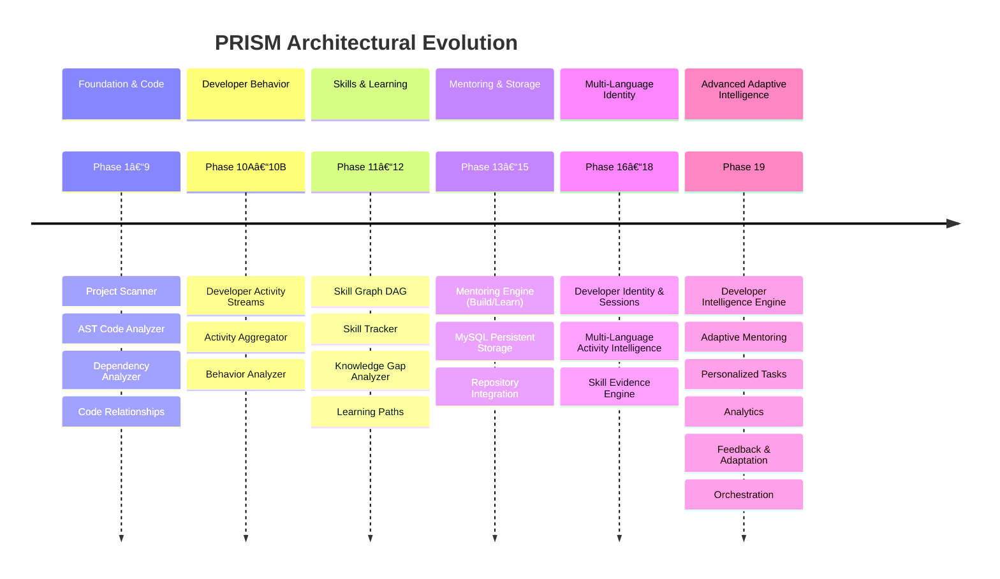

# PRISM Architecture Documentation

> **Personalized Real-time Intelligent Skill Mentor**
> Complete Architectural Reference, System Design, Data Flow, and Technical Audit
> **Repository:** `deepakjangid11/PRISM-IDE`
> **Status:** Phase 19 Completed | Python 3.14.7 | FastAPI | MySQL 8.0+ | SQLAlchemy 2.0

---

## 1. Documentation Index

This directory contains the comprehensive, developer-friendly internal architecture documentation for PRISM. Every document is grounded in the actual codebase, referencing real class names, functions, file paths, database tables, and API routes.

| Document | Description |
|---|---|
| [**1. System Architecture**](system_architecture.md) | High-level system overview, architectural layers, core subsystem responsibilities, and global component communication topology. |
| [**2. Intelligence Pipeline**](intelligence_pipeline.md) | Step-by-step end-to-end telemetry and intelligence data flow from IDE event ingestion down to skill tracking, gap analysis, and feedback loops. |
| [**3. Phase 19 Deep Architecture**](phase_19_architecture.md) | Exhaustive breakdown of Phase 19 advanced intelligence engines: Developer Intelligence, Adaptive Mentoring, Task Recommendation, Analytics, Feedback, Adaptation, and Orchestrator. |
| [**4. Database Architecture**](database_architecture.md) | Complete MySQL 8.0+ database schema, 17 SQLAlchemy ORM models, Mermaid Entity-Relationship (ER) diagram, repository pattern, and dual in-memory/MySQL parity. |
| [**5. API Architecture**](api_architecture.md) | Exhaustive REST API catalog detailing all 62 FastAPI endpoints across 12 route modules with HTTP methods, payload schemas, and service bindings. |
| [**6. Execution Flows**](execution_flows.md) | Detailed Mermaid sequence diagrams illustrating runtime execution sequences for activity logging, skill updates, task evaluation, adaptive mentoring, and orchestration. |
| [**7. Architecture Audit**](architecture_audit.md) | Senior Architect technical audit assessing coupling, performance bottlenecks, database operations, scalability risks, authentication gaps, and optimization opportunities. |

---

## 2. System Mission & Core Philosophy

PRISM is an IDE-independent AI Developer Intelligence and Personalized Learning Platform. Unlike superficial activity trackers or static code linters, PRISM's primary mission is to:

1. **Understand Developer Identity & Behavior:** Track developers consistently across IDE instances, CLI tools, and Git workflows; reconstruct developer working sessions; uncover genuine behavioral patterns (e.g., test-driven development, trial-and-error debugging, context fragmentation).
2. **Understand Project Architecture:** Parse codebases into AST syntax trees, analyze cross-module dependencies, and map structural code relationships.
3. **Assess Technical Competence Through Verifiable Evidence:** Evaluate skills strictly through observable technical artifacts (`SkillEvidence` from code edits, passing test runs, resolved bugs, and merged features) with diminishing returns and multi-project diversity verification—eliminating superficial event-count inflation.
4. **Identify Knowledge Gaps Dynamically:** Traverse a directed technical `SkillGraph` to discover missing prerequisites, under-proficient competencies, and career role deficiencies (e.g., *Backend Developer*, *Machine Learning Engineer*).
5. **Close Competency Gaps with Adaptive Mentoring:** Recommend targeted, bite-sized practice tasks (`PersonalizedTask`), adapt pedagogical mentoring strategies (`AdaptiveMentoringEngine`), evaluate task outcomes into verifiable skill proof, and recalibrate learning pathways in real time.

---

## 3. High-Level Technology Stack

* **Runtime:** Python 3.14.7 (managed via `uv`)
* **API Framework:** FastAPI 0.115+ (Pydantic V2 schemas with `extra="forbid"`)
* **ORM & Database:** SQLAlchemy 2.0 (strict MySQL 8.0+ InnoDB engine, `utf8mb4_0900_ai_ci` collation, zero SQLite)
* **Architecture Pattern:** Clean Layered Architecture with Dependency Injection, Repository Pattern, and Strategy Pattern
* **Testing & Quality:** Pytest (315 tests passing, 90.01% code coverage), Ruff (100% linting and formatting compliance), MyPy (100% type check pass across 156 files)

---

## 4. Architectural Evolution Summary (Phases 1–19)

