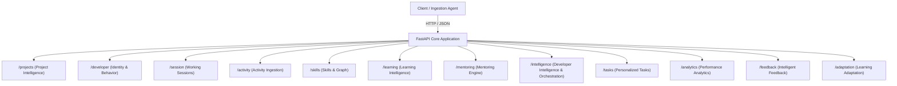

# PRISM API Architecture & Endpoint Catalog

> **Document Version:** 1.0.0  
> **API Framework:** FastAPI 0.115+  
> **Specification:** OpenAPI 3.1.0 (`/openapi.json`, `/docs`, `/redoc`)  
> **Total Active Endpoints:** 62 endpoints across 12 route modules  
> **Source Files Referenced:** `src/prism/api/routes/`, `src/prism/api/main.py`  

---

## 1. API Architecture Overview

The PRISM API layer is organized into domain-specific APIRouters mounted onto the central FastAPI application in `src/prism/api/main.py`. Every route uses strict Pydantic V2 schemas with `extra="forbid"` to prevent mass-assignment and ensure payload integrity.

---

## 2. Exhaustive Endpoint Catalog by Domain

### 2.1 Project Intelligence (`src/prism/api/routes/project.py`)

| Method | Path | Purpose | Request Body / Query | Response Structure | Engine / Service Called |
|---|---|---|---|---|---|
| `POST` | `/projects/analyze` | Parse project files via AST, extracting classes, functions, and imports. | `ProjectAnalysisRequest(project_path)` | `ProjectAnalysisResponse(files_scanned, syntax_valid)` | `ProjectScanner`, `CodeAnalyzer` |
| `POST` | `/projects/intelligence` | Generate full structural, dependency, and relationship intelligence. | `ProjectIntelligenceRequest(project_path)` | `ProjectIntelligenceResponse(context, dependencies, relationships)` | `ProjectIntelligenceService` |

---

### 2.2 Developer Identity & Behavior (`src/prism/api/routes/developer.py`)

| Method | Path | Purpose | Request Body / Query | Response Structure | Engine / Service Called |
|---|---|---|---|---|---|
| `POST` | `/developer/register` | Register new developer identity with email and canonical profile fields. | `DeveloperRegistrationRequest(name, email, experience_level, primary_role)` | `DeveloperResponse(developer_id, name, email, created_at)` | `DeveloperIdentityService` |
| `POST` | `/developer/identify` | Resolve developer ID from email or external provider handles. | `DeveloperIdentifyRequest(email)` | `DeveloperResponse(developer_id, ...)` | `DeveloperIdentityService` |
| `GET` | `/developer/{developer_id}/profile` | Retrieve developer identity profile and metadata. | Path: `developer_id` | `DeveloperProfileResponse(...)` | `DeveloperIdentityService` |
| `PUT` | `/developer/{developer_id}/profile` | Update developer experience level, role, or preferences. | `UpdateDeveloperProfileRequest(...)` | `DeveloperProfileResponse(...)` | `DeveloperIdentityService` |
| `POST` | `/developer/behavior` | Analyze developer behavior and work patterns from telemetry. | `BehaviorAnalysisRequest(developer_id, window_hours)` | `DeveloperBehaviorInsights(testing_discipline, error_rates)` | `DeveloperBehaviorAnalyzer` |
| `POST` | `/developer/skills/record` | Record observable skill evidence. | `SkillEvidenceRequest(...)` | `SkillEvidenceResponse(...)` | `SkillTracker` |
| `GET` | `/developer/skills/graph` | Retrieve active skill graph topology. | None | `SkillGraphResponse(...)` | `SkillGraph` |
| `GET` | `/developer/skills/{developer_id}` | Retrieve assessed skill profile for a developer. | Path: `developer_id` | `DeveloperSkillProfileResponse(...)` | `SkillTracker` |
| `POST` | `/developer/session/start` | Start working session for developer. | `StartSessionRequest(developer_id)` | `SessionResponse(session_id, status)` | `DeveloperSessionService` |
| `POST` | `/developer/session/heartbeat` | Send session heartbeat to maintain active state. | `HeartbeatRequest(session_id)` | `SessionResponse(session_id, status)` | `DeveloperSessionService` |
| `POST` | `/developer/session/end` | Gracefully end developer working session. | `EndSessionRequest(session_id, reason)` | `SessionResponse(session_id, status)` | `DeveloperSessionService` |
| `GET` | `/developer/session/active/{developer_id}` | Query current unexpired session. | Path: `developer_id` | `SessionResponse(...)` | `DeveloperSessionService` |
| `GET` | `/developer/session/history/{developer_id}` | Retrieve historical session records. | Path: `developer_id`, Query: `limit, offset` | `list[SessionResponse]` | `DeveloperSessionService` |

---

### 2.3 Working Sessions (`src/prism/api/routes/session.py`)

| Method | Path | Purpose | Request Body / Query | Response Structure | Engine / Service Called |
|---|---|---|---|---|---|
| `POST` | `/session/start` | Canonical endpoint to start a developer session. | `StartSessionRequest(developer_id)` | `SessionResponse(session_id, started_at)` | `DeveloperSessionService` |
| `POST` | `/session/heartbeat` | Touch session activity heartbeat. | `HeartbeatRequest(session_id)` | `SessionResponse(session_id, last_heartbeat_at)` | `DeveloperSessionService` |
| `POST` | `/session/end` | Terminate active working session. | `EndSessionRequest(session_id, reason)` | `SessionResponse(session_id, ended_at)` | `DeveloperSessionService` |
| `GET` | `/session/active/{developer_id}` | Query currently active session. | Path: `developer_id` | `SessionResponse(...)` | `DeveloperSessionService` |
| `GET` | `/session/history/{developer_id}` | Query historical session durations and active times. | Path: `developer_id`, Query: `limit, offset` | `list[SessionResponse]` | `DeveloperSessionService` |

---

### 2.4 Activity Ingestion & Intelligence (`src/prism/api/routes/activity.py`)

| Method | Path | Purpose | Request Body / Query | Response Structure | Engine / Service Called |
|---|---|---|---|---|---|
| `POST` | `/activity/record` | Ingest single IDE telemetry event with session binding. | `DeveloperActivity(event_id, developer_id, event_type, project_path, ...)` | `ActivityRecordResponse(status="recorded", event_id)` | `ActivityRecorder` |
| `POST` | `/activity/batch` | Ingest batch of telemetry events in single transaction. | `list[DeveloperActivity]` | `BatchActivityResponse(recorded_count)` | `ActivityRecorder` |
| `GET` | `/activity/history/{developer_id}` | Query raw activity logs for developer. | Path: `developer_id`, Query: `limit, offset` | `list[DeveloperActivity]` | `ActivityRepository` |
| `GET` | `/activity/session/{session_id}` | Query activities executed within a specific session. | Path: `session_id` | `list[DeveloperActivity]` | `ActivityRepository` |
| `GET` | `/activity/summary/{developer_id}` | Multi-language activity intelligence summary. | Path: `developer_id` | `ActivitySummaryResponse(total_events, language_breakdown)` | `DeveloperActivityIntelligenceService` |
| `GET` | `/activity/analytics/{developer_id}` | Activity metrics, active minutes, and rhythm. | Path: `developer_id` | `ActivityAnalyticsResponse(...)` | `DeveloperActivityIntelligenceService` |
| `GET` | `/activity/languages/{developer_id}` | Language distribution breakdown across projects. | Path: `developer_id` | `dict[str, int]` | `ActivityAggregationEngine` |

---

### 2.5 Skills & Graph Intelligence (`src/prism/api/routes/skills.py`)

| Method | Path | Purpose | Request Body / Query | Response Structure | Engine / Service Called |
|---|---|---|---|---|---|
| `GET` | `/skills/profile/{developer_id}` | Retrieve multidimensional skill profile with rollups. | Path: `developer_id` | `DeveloperSkillProfile` | `SkillTracker` |
| `POST` | `/skills/evidence` | Ingest verifiable skill evidence and update scoring. | `SkillEvidence(...)` | `SkillEvidenceResponse(evidence_id, status)` | `SkillEvidenceEngine`, `SkillTracker` |
| `GET` | `/skills/evidence/{developer_id}` | Chronological skill evidence records with filtering. | Path: `developer_id`, Query: `skill_name, limit` | `list[SkillEvidence]` | `SkillRepository` |
| `GET` | `/skills/proficiency/{developer_id}` | Complete assessed skill competencies map. | Path: `developer_id` | `dict[str, DeveloperSkill]` | `SkillTracker` |
| `GET` | `/skills/proficiency/{developer_id}/{skill_id}` | Assessed proficiency and explainability reasoning for single skill. | Path: `developer_id, skill_id` | `DeveloperSkill` | `SkillTracker` |
| `GET` | `/skills/graph` | Full or filtered skill graph topology snapshot. | Query: `category, language` | `SkillGraphSnapshot(nodes, edges)` | `SkillGraph` |
| `GET` | `/skills/graph/{skill_id}` | Detailed `SkillNode` metadata and description. | Path: `skill_id` | `SkillNode` | `SkillGraph` |
| `GET` | `/skills/prerequisites/{skill_id}` | Direct or transitive prerequisite skills. | Path: `skill_id`, Query: `transitive: bool` | `list[str]` | `SkillGraph` |
| `GET` | `/skills/related/{skill_id}` | Related adjacent technical concepts. | Path: `skill_id` | `list[str]` | `SkillGraph` |
| `POST` | `/skills/gap-analysis` | Analyze competency gaps for target skill or role. | `GapAnalysisRequest(developer_id, target_goal, target_role)` | `list[SkillGap]` | `KnowledgeGapAnalyzer` |
| `GET` | `/skills/gaps/{developer_id}` | Query detected gaps for developer. | Path: `developer_id`, Query: `target_role` | `list[SkillGap]` | `KnowledgeGapAnalyzer` |
| `GET` | `/skills/recommendations/{developer_id}` | Prioritized, effort-estimated learning recommendations. | Path: `developer_id`, Query: `target_role` | `list[LearningRecommendation]` | `LearningRecommendationEngine` |
| `POST` | `/skills/learning-path` | Generate dependency-aware topological learning path. | `LearningPathRequest(developer_id, target_goal)` | `LearningPath(ordered_skills, estimated_hours)` | `LearningPathGenerator` |
| `GET` | `/skills/learning-path/{developer_id}` | Query tailored learning path for skill or role. | Path: `developer_id`, Query: `target_role` | `LearningPath` | `LearningPathGenerator` |

---

### 2.6 Learning Intelligence (`src/prism/api/routes/learning.py`)

| Method | Path | Purpose | Request Body / Query | Response Structure | Engine / Service Called |
|---|---|---|---|---|---|
| `POST` | `/learning/gaps` | Identify knowledge gaps against target competency. | `GapAnalysisRequest(...)` | `list[SkillGap]` | `KnowledgeGapAnalyzer` |
| `POST` | `/learning/paths` | Generate ordered learning pathway. | `LearningPathRequest(...)` | `LearningPath` | `LearningPathGenerator` |
| `POST` | `/learning/recommendations` | Get prioritized learning recommendations. | `RecommendationRequest(...)` | `list[LearningRecommendation]` | `LearningRecommendationEngine` |

---

### 2.7 Mentoring Subsystem (`src/prism/api/routes/mentoring.py`)

| Method | Path | Purpose | Request Body / Query | Response Structure | Engine / Service Called |
|---|---|---|---|---|---|
| `POST` | `/mentoring/request` | Submit standard mentoring query in Build or Learn Mode. | `MentorRequest(developer_id, query, mode, project_context)` | `MentorResponse(explanation, steps, code_snippets)` | `MentoringEngine` |
| `POST` | `/mentoring/adaptive` | Request personalized, strategy-tailored mentoring. | `AdaptiveMentorRequest(developer_id, query, target_skill, preferred_strategy)` | `AdaptiveMentorResponse(selected_strategy, complexity, steps, suggested_task)` | `AdaptiveMentoringEngine` |
| `GET` | `/mentoring/history/{developer_id}` | Historical mentoring session logs. | Path: `developer_id`, Query: `limit` | `list[MentoringSessionRecord]` | `AdaptiveMentoringEngine` |
| `GET` | `/mentoring/effectiveness/{developer_id}` | Quantified effectiveness score and strategy breakdown. | Path: `developer_id` | `MentoringEffectiveness(score, strategy_distribution)` | `AdaptiveMentoringEngine` |

---

### 2.8 Developer Intelligence & Orchestration (`src/prism/api/routes/intelligence.py`)

| Method | Path | Purpose | Request Body / Query | Response Structure | Engine / Service Called |
|---|---|---|---|---|---|
| `GET` | `/intelligence/profile/{developer_id}` | Comprehensive developer intelligence profile. | Path: `developer_id` | `DeveloperIntelligenceProfile` | `DeveloperIntelligenceEngine` |
| `GET` | `/intelligence/insights/{developer_id}` | Categorized strengths, gaps, and error insights. | Path: `developer_id`, Query: `category` | `list[DeveloperInsight]` | `DeveloperIntelligenceEngine` |
| `GET` | `/intelligence/trends/{developer_id}` | Skill proficiency trajectories and growth rates. | Path: `developer_id` | `list[SkillTrend]` | `DeveloperIntelligenceEngine` |
| `POST` | `/intelligence/refresh` | Force re-analysis and profile refresh. | `RefreshIntelligenceRequest(developer_id)` | `DeveloperIntelligenceProfile` | `DeveloperIntelligenceEngine` |
| `POST` | `/intelligence/orchestrate/activity` | Ingest activity and trigger reactive recalibration. | `DeveloperActivity(...)` | `dict[str, Any]` (status="success", evidence_id) | `CrossModuleIntelligenceOrchestrator` |
| `POST` | `/intelligence/orchestrate/sync` | Full multi-module sync (profile, gaps, tasks, strategy). | `SyncIntelligenceRequest(developer_id, target_role)` | `dict[str, Any]` (status="synced", active_strategy) | `CrossModuleIntelligenceOrchestrator` |

---

### 2.9 Personalized Tasks (`src/prism/api/routes/tasks.py`)

| Method | Path | Purpose | Request Body / Query | Response Structure | Engine / Service Called |
|---|---|---|---|---|---|
| `POST` | `/tasks/generate` | Generate gap-targeted personalized tasks. | `GenerateTasksRequest(developer_id, target_role, limit)` | `list[PersonalizedTask]` | `TaskRecommendationEngine` |
| `GET` | `/tasks/recommendations/{developer_id}` | Query recommended tasks for developer. | Path: `developer_id`, Query: `limit` | `list[PersonalizedTask]` | `TaskRecommendationEngine` |
| `GET` | `/tasks/{task_id}` | Fetch task details and acceptance criteria. | Path: `task_id` | `PersonalizedTask` | `TaskRecommendationEngine` |
| `PATCH` | `/tasks/{task_id}/status` | Update task progress status and execution notes. | `UpdateTaskStatusRequest(status, notes)` | `PersonalizedTask` | `TaskRecommendationEngine` |
| `POST` | `/tasks/{task_id}/evaluate` | Evaluate task completion, record outcome, and emit evidence. | `EvaluateTaskRequest(developer_id, passed, score, execution_notes, verified_artifacts)` | `TaskEvaluation(score, passed, generated_evidence_id)` | `TaskRecommendationEngine` |

---

### 2.10 Performance Analytics (`src/prism/api/routes/analytics.py`)

| Method | Path | Purpose | Request Body / Query | Response Structure | Engine / Service Called |
|---|---|---|---|---|---|
| `GET` | `/analytics/performance/{developer_id}` | Overview analytics with role readiness. | Path: `developer_id` | `PerformanceOverviewResponse(role_readiness, ...)` | `DeveloperPerformanceAnalytics` |
| `GET` | `/analytics/improvement/{developer_id}` | Longitudinal skill improvement velocity. | Path: `developer_id` | `SkillImprovementResponse(improving_skills, ...)` | `DeveloperPerformanceAnalytics` |
| `GET` | `/analytics/learning/{developer_id}` | Learning progress and task completion throughput. | Path: `developer_id` | `LearningProgressResponse(...)` | `DeveloperPerformanceAnalytics` |
| `GET` | `/analytics/history/{developer_id}` | Historical performance checkpoint snapshots. | Path: `developer_id`, Query: `limit, offset` | `list[DeveloperPerformanceSnapshot]` | `DeveloperPerformanceAnalytics` |

---

### 2.11 Intelligent Feedback (`src/prism/api/routes/feedback.py`)

| Method | Path | Purpose | Request Body / Query | Response Structure | Engine / Service Called |
|---|---|---|---|---|---|
| `GET` | `/feedback/{developer_id}` | Query recent proactive feedback items. | Path: `developer_id`, Query: `limit` | `list[DeveloperFeedback]` | `IntelligentFeedbackEngine` |
| `POST` | `/feedback/generate` | Trigger on-demand constructive feedback generation. | `TriggerFeedbackRequest(developer_id)` | `list[DeveloperFeedback]` | `IntelligentFeedbackEngine` |
| `GET` | `/feedback/history/{developer_id}` | Longitudinal feedback history audit trail. | Path: `developer_id`, Query: `limit` | `list[DeveloperFeedback]` | `IntelligentFeedbackEngine` |

---

### 2.12 Learning Adaptation (`src/prism/api/routes/adaptation.py`)

| Method | Path | Purpose | Request Body / Query | Response Structure | Engine / Service Called |
|---|---|---|---|---|---|
| `POST` | `/adaptation/adapt` | Recalibrate pedagogical learning strategy. | `AdaptStrategyRequest(developer_id)` | `LearningAdaptation(previous_strategy, new_strategy, reason)` | `LearningAdaptationEngine` |
| `GET` | `/adaptation/strategy/{developer_id}` | Retrieve active learning strategy. | Path: `developer_id` | `LearningAdaptation` | `LearningAdaptationEngine` |
| `GET` | `/adaptation/history/{developer_id}` | Longitudinal strategy adaptation history. | Path: `developer_id`, Query: `limit` | `list[LearningAdaptation]` | `LearningAdaptationEngine` |
