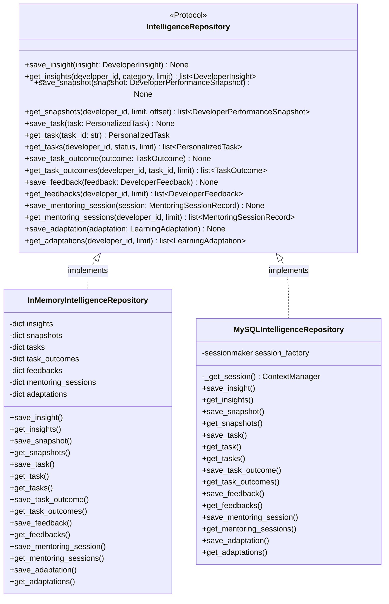
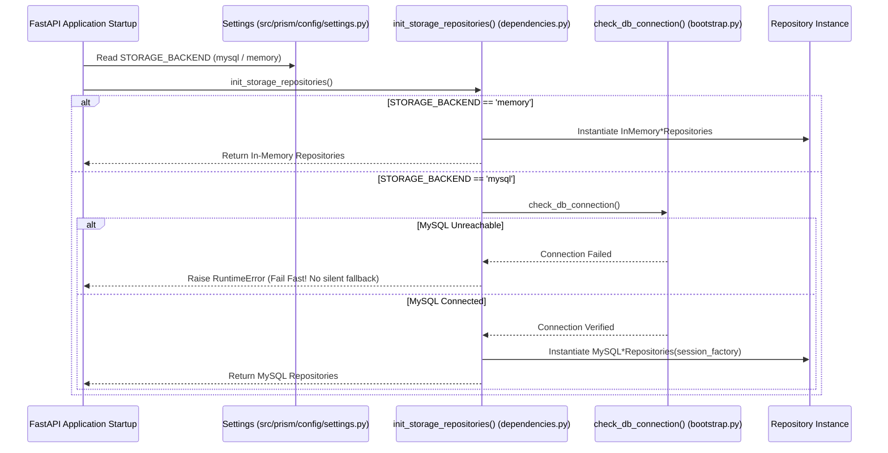

# PRISM Database Architecture & Entity-Relationship Design

> **Document Version:** 1.0.0  
> **Target Database Engine:** MySQL Server 8.0+ (InnoDB Engine)  
> **Character Set & Collation:** `utf8mb4` / `utf8mb4_0900_ai_ci`  
> **ORM Framework:** SQLAlchemy 2.0 (Declarative Base, Scoped Sessions)  
> **Source Files Referenced:** `src/prism/storage/models/`, `src/prism/storage/repositories/`  

---

## 1. Complete Entity-Relationship (ER) Diagram

The diagram below reflects all **17 relational database tables**, their primary keys (PK), foreign keys (FK), and exact directional cardinalities as defined in the SQLAlchemy models.

```mermaid
erDiagram
    developers ||--o{ developer_sessions : "starts (1:N)"
    developers ||--o{ developer_activities : "performs (1:N)"
    developers ||--o{ developer_skills : "has assessed (1:N)"
    developers ||--o{ skill_evidence : "demonstrates (1:N)"
    developers ||--o{ learning_progress : "tracks (1:N)"
    developers ||--o{ learning_progress_history : "logs history (1:N)"
    developers ||--o{ developer_insights : "receives (1:N)"
    developers ||--o{ developer_performance_snapshots : "captures (1:N)"
    developers ||--o{ personalized_tasks : "assigned (1:N)"
    developers ||--o{ task_outcomes : "completes (1:N)"
    developers ||--o{ developer_feedbacks : "receives feedback (1:N)"
    developers ||--o{ mentoring_sessions : "attends (1:N)"
    developers ||--o{ learning_adaptations : "adapts strategy (1:N)"

    skills ||--o{ skill_relationships : "originates from_skill (1:N)"
    skills ||--o{ skill_relationships : "targets to_skill (1:N)"
    skills ||--o{ developer_skills : "rated under (1:N)"
    skills ||--o{ skill_evidence : "proven by (1:N)"
    skills ||--o{ learning_progress : "targeted as goal (1:N)"
    skills ||--o{ learning_progress_items : "itemized in (1:N)"
    skills ||--o{ learning_progress_history : "referenced in (1:N)"

    learning_progress ||--o{ learning_progress_items : "contains (1:N)"
    learning_progress ||--o{ learning_progress_history : "records checkpoint (1:N)"

    personalized_tasks ||--o{ task_outcomes : "evaluated in (1:N)"

    developers {
        VARCHAR_64 developer_id PK
        VARCHAR_255 name
        VARCHAR_255 email
        VARCHAR_64 experience_level
        VARCHAR_128 primary_role
        DATETIME created_at
        DATETIME updated_at
    }

    developer_sessions {
        INT id PK
        VARCHAR_64 session_id UK
        VARCHAR_64 developer_id FK
        VARCHAR_32 status
        DATETIME started_at
        DATETIME last_heartbeat_at
        DATETIME ended_at
        VARCHAR_64 end_reason
        INT duration_seconds
        INT active_duration_seconds
    }

    developer_activities {
        VARCHAR_64 event_id PK
        VARCHAR_64 developer_id FK
        VARCHAR_64 event_type
        DATETIME timestamp
        VARCHAR_512 project_path
        VARCHAR_512 file_path
        VARCHAR_64 session_id
        JSON activity_metadata
    }

    skills {
        VARCHAR_64 skill_id PK
        VARCHAR_128 name
        VARCHAR_64 category
        VARCHAR_64 language
        VARCHAR_32 difficulty
        TEXT description
        JSON tags
    }

    skill_relationships {
        INT id PK
        VARCHAR_64 from_skill_id FK
        VARCHAR_64 to_skill_id FK
        VARCHAR_64 relationship_type
    }

    developer_skills {
        INT id PK
        VARCHAR_64 developer_id FK
        VARCHAR_64 skill_id FK
        VARCHAR_32 proficiency_level
        FLOAT proficiency_score
        INT evidence_count
        FLOAT confidence
        DATETIME last_assessed_at
        TEXT reasoning
    }

    skill_evidence {
        VARCHAR_64 evidence_id PK
        VARCHAR_64 developer_id FK
        VARCHAR_64 skill_id FK
        VARCHAR_128 skill_name
        VARCHAR_512 project_path
        VARCHAR_64 programming_language
        VARCHAR_64 framework
        VARCHAR_64 evidence_source
        VARCHAR_64 evidence_type
        TEXT description
        FLOAT evidence_strength
        FLOAT confidence_score
        FLOAT complexity_score
        DATETIME timestamp
        VARCHAR_64 related_activity_id
        JSON evidence_metadata
    }

    learning_progress {
        VARCHAR_64 progress_id PK
        VARCHAR_64 developer_id FK
        VARCHAR_64 target_goal_skill_id FK
        VARCHAR_128 target_role
        FLOAT completion_percentage
        VARCHAR_32 status
        DATETIME started_at
        DATETIME updated_at
    }

    learning_progress_items {
        INT id PK
        VARCHAR_64 progress_id FK
        VARCHAR_64 skill_id FK
        VARCHAR_32 status
        INT order_index
    }

    learning_progress_history {
        VARCHAR_64 history_id PK
        VARCHAR_64 progress_id FK
        VARCHAR_64 developer_id FK
        VARCHAR_64 target_goal_skill_id FK
        FLOAT completion_percentage
        DATETIME recorded_at
    }

    developer_insights {
        VARCHAR_64 insight_id PK
        VARCHAR_64 developer_id FK
        VARCHAR_32 category
        VARCHAR_255 title
        TEXT description
        VARCHAR_32 severity
        JSON evidence
        JSON supporting_skills
        TEXT actionable_recommendation
        DATETIME created_at
    }

    developer_performance_snapshots {
        VARCHAR_64 snapshot_id PK
        VARCHAR_64 developer_id FK
        DATETIME timestamp
        INT total_activities
        INT verified_skills_count
        FLOAT average_proficiency_score
        INT active_knowledge_gaps_count
        INT tasks_completed_count
        FLOAT task_success_rate
        FLOAT learning_consistency_score
        JSON role_readiness_scores
    }

    personalized_tasks {
        VARCHAR_64 task_id PK
        VARCHAR_64 developer_id FK
        VARCHAR_255 title
        TEXT description
        VARCHAR_128 target_skill
        VARCHAR_32 difficulty
        VARCHAR_32 priority
        INT estimated_minutes
        JSON acceptance_criteria
        JSON prerequisites
        VARCHAR_32 status
        TEXT notes
        DATETIME created_at
        DATETIME updated_at
    }

    task_outcomes {
        VARCHAR_64 outcome_id PK
        VARCHAR_64 task_id FK
        VARCHAR_64 developer_id FK
        BOOLEAN success
        FLOAT score
        INT completion_time_minutes
        TEXT execution_notes
        JSON submitted_artifacts
        DATETIME evaluated_at
    }

    developer_feedbacks {
        VARCHAR_64 feedback_id PK
        VARCHAR_64 developer_id FK
        VARCHAR_32 category
        VARCHAR_255 title
        TEXT message
        JSON actionable_steps
        VARCHAR_128 related_skill
        DATETIME created_at
    }

    mentoring_sessions {
        VARCHAR_64 session_id PK
        VARCHAR_64 developer_id FK
        VARCHAR_64 strategy
        TEXT query
        VARCHAR_128 target_skill
        TEXT summary
        FLOAT outcome_rating
        DATETIME created_at
    }

    learning_adaptations {
        VARCHAR_64 adaptation_id PK
        VARCHAR_64 developer_id FK
        VARCHAR_64 previous_strategy
        VARCHAR_64 new_strategy
        TEXT reason
        JSON trigger_metrics
        DATETIME adapted_at
    }
```

---

## 2. Table-by-Table Schema Specification

### 2.1 Identity & Session Subsystem
1. **`developers` (`DeveloperRecord`)**:
   * Master entity for developer profiles.
   * `developer_id`: `VARCHAR(64)` PRIMARY KEY.
   * `name`: `VARCHAR(255)`, `email`: `VARCHAR(255)` UNIQUE, `experience_level`: `VARCHAR(64)`, `primary_role`: `VARCHAR(128)`.
   * Indexes: `ix_developers_email`, `ix_developers_created_at`.
2. **`developer_sessions` (`DeveloperSessionRecord`)**:
   * Working sessions with active heartbeat timestamps.
   * `session_id`: `VARCHAR(64)` UNIQUE INDEX.
   * `developer_id`: Foreign key referencing `developers.developer_id`.
   * Indexes: `ix_dev_sessions_dev_id`, `ix_dev_sessions_status`.
3. **`developer_activities` (`DeveloperActivityRecord`)**:
   * Raw IDE telemetry stream.
   * `event_id`: `VARCHAR(64)` PRIMARY KEY.
   * `developer_id`: Foreign key referencing `developers.developer_id`.
   * `activity_metadata`: Native MySQL `JSON` storing language details, line edits, and error tracebacks.

### 2.2 Skill & Evidence Subsystem
4. **`skills` (`SkillRecord`)**:
   * Skill nodes in the competency graph.
   * `skill_id`: `VARCHAR(64)` PRIMARY KEY (e.g. `python`, `fastapi`, `sqlalchemy`).
   * `tags`: Native MySQL `JSON` array of string tags.
5. **`skill_relationships` (`SkillRelationshipRecord`)**:
   * Directed edges between skills.
   * `from_skill_id` and `to_skill_id`: Foreign keys referencing `skills.skill_id`.
   * `relationship_type`: `VARCHAR(64)` (`prerequisite`, `related`, `specialization_of`).
6. **`developer_skills` (`DeveloperSkillRecord`)**:
   * Developer-assessed proficiency.
   * Unique composite constraint on `(developer_id, skill_id)`.
   * `proficiency_score`: `FLOAT` (0.0 to 100.0).
7. **`skill_evidence` (`SkillEvidenceRecord`)**:
   * Immutable verifiable evidence artifacts.
   * `evidence_id`: `VARCHAR(64)` PRIMARY KEY.
   * Foreign keys to `developers.developer_id` and `skills.skill_id`.
   * `evidence_metadata`: Native MySQL `JSON` storing commit hashes, AST metrics, and test outputs.

### 2.3 Learning Subsystem
8. **`learning_progress` (`LearningProgressRecord`)**:
   * Tracks active learning pathways toward a target goal.
   * Foreign keys to `developers.developer_id` and `skills.skill_id` (`target_goal_skill_id`).
9. **`learning_progress_items` (`LearningProgressItemRecord`)**:
   * Ordered sequence of milestones along a path.
   * Foreign keys to `learning_progress.progress_id` and `skills.skill_id`.
10. **`learning_progress_history` (`LearningProgressHistoryRecord`)**:
    * Audit trail of completion percentage checkpoints over time.

### 2.4 Phase 19 Advanced Intelligence Subsystem
11. **`developer_insights` (`DeveloperInsightRecord`)**:
    * Categorized insights (`STRENGTH`, `GAP`, `RECURRING_ERROR`, `VELOCITY_SLOWDOWN`, `GROWTH`).
    * `evidence` and `supporting_skills`: Native MySQL `JSON`.
    * Indexes: `ix_dev_insights_dev_id`, `ix_dev_insights_category`, `ix_dev_insights_created_at`.
12. **`developer_performance_snapshots` (`DeveloperPerformanceSnapshotRecord`)**:
    * Point-in-time performance checkpoints.
    * `role_readiness_scores`: Native MySQL `JSON` mapping role names to readiness percentages.
13. **`personalized_tasks` (`PersonalizedTaskRecord`)**:
    * Gap-targeted practice tasks.
    * `acceptance_criteria` and `prerequisites`: Native MySQL `JSON`.
    * Indexes: `ix_tasks_dev_id`, `ix_tasks_status`, `ix_tasks_target_skill`.
14. **`task_outcomes` (`TaskOutcomeRecord`)**:
    * Task completion evaluations.
    * `task_id`: Foreign key referencing `personalized_tasks.task_id`.
    * `submitted_artifacts`: Native MySQL `JSON` storing file paths or test logs.
15. **`developer_feedbacks` (`DeveloperFeedbackRecord`)**:
    * Constructive feedback items.
    * `actionable_steps`: Native MySQL `JSON` containing ordered next-step guidance.
16. **`mentoring_sessions` (`MentoringSessionRecordEntity`)**:
    * Historical logs of adaptive mentoring dialogues.
    * Indexes: `ix_mentor_sessions_dev_id`, `ix_mentor_sessions_strategy`.
17. **`learning_adaptations` (`LearningAdaptationRecord`)**:
    * Recalibration log tracking shifts between learning strategies.
    * `trigger_metrics`: Native MySQL `JSON` capturing success rate, error counts, and gap counts.

---

## 3. Storage Architecture: Protocols vs. Dual Implementations

PRISM employs the **Repository Pattern** to completely isolate business logic from database storage engines.

### 3.1 `IntelligenceRepository` Protocol (`src/prism/storage/repositories/base.py`)
* Written using `typing.Protocol` with `@runtime_checkable`.
* Defines the strict contract for domain operations without referencing SQLAlchemy or MySQL types.
* Domain engines (`DeveloperIntelligenceEngine`, `AdaptiveMentoringEngine`, `TaskRecommendationEngine`) depend exclusively on this protocol.

### 3.2 `InMemoryIntelligenceRepository` (`src/prism/storage/repositories/memory_repo.py`)
* In-memory implementation using thread-safe Python dictionaries.
* Eliminates external network calls or database setups during unit testing.
* Provides identical filtering, ordering, and pagination logic as the MySQL queries.

### 3.3 `MySQLIntelligenceRepository` (`src/prism/storage/repositories/mysql_intelligence_repo.py`)
* Production implementation using SQLAlchemy 2.0.
* Manages scoped sessions via context managers (`session_scope()`), guaranteeing transactional rollback on errors.
* Handles JSON serialization/deserialization between Pydantic domain models and native MySQL `JSON` columns.
* Implements UPSERT semantics (e.g. updating task status and notes on duplicate task IDs).

---

## 4. Database Selection & Dependency Injection Flow

The repository implementation is selected deterministically at application startup based on `STORAGE_BACKEND`:

> **Design Principle: Fail-Fast in Production**  
> If `STORAGE_BACKEND=mysql` is configured and MySQL is unreachable, PRISM explicitly refuses to boot. Silent in-memory fallback in production environments is forbidden to prevent catastrophic silent data loss.
