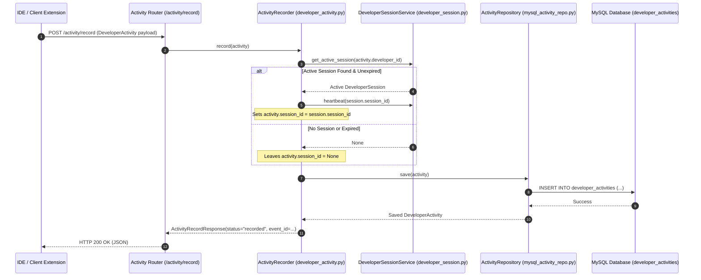
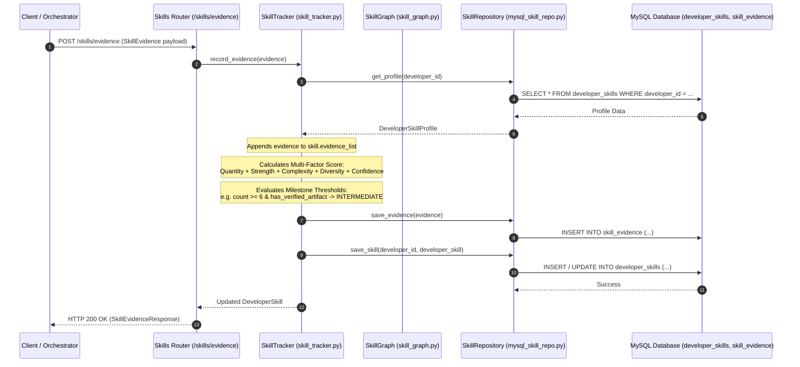
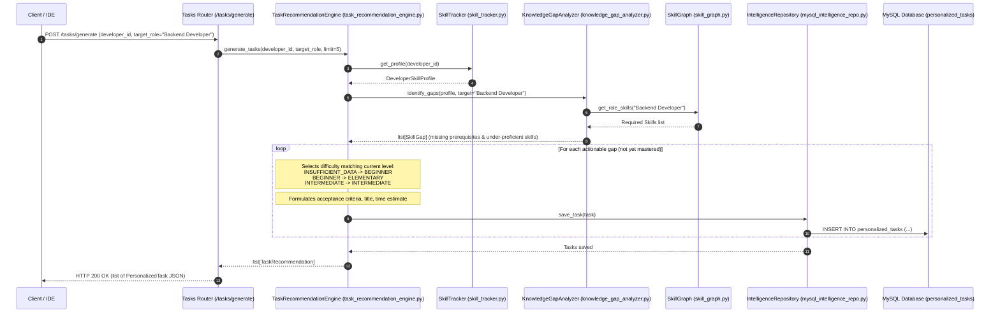
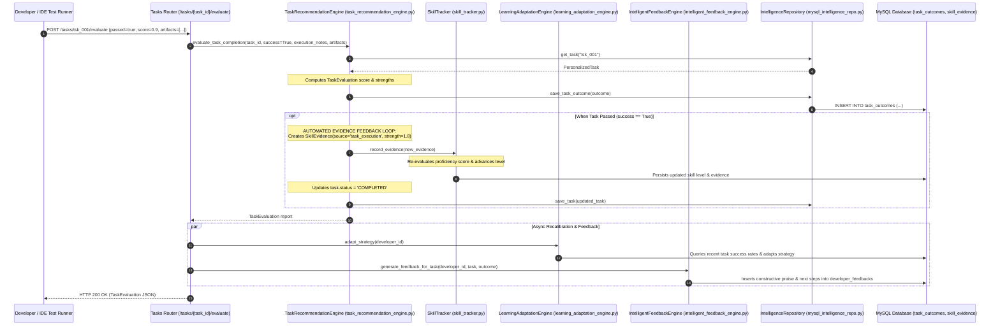
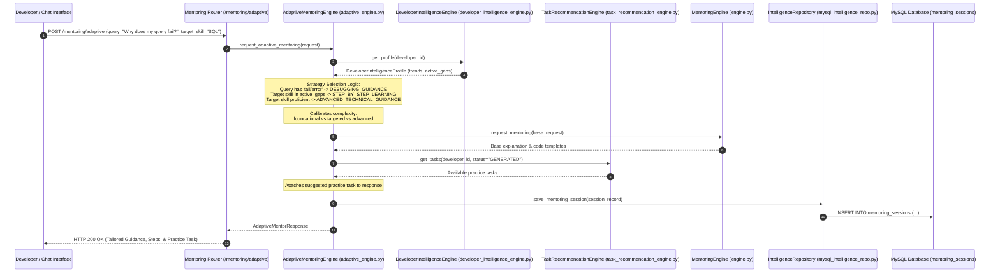
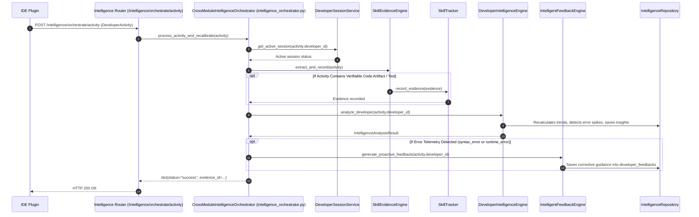
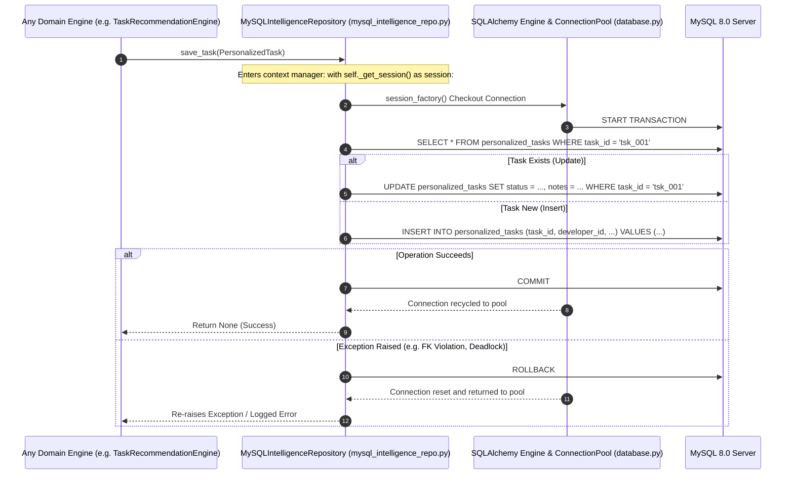

# PRISM Execution Sequences & Runtime Workflows

> **Document Version:** 1.0.0  
> **Source Files Referenced:** `src/prism/api/routes/`, `src/prism/intelligence/`, `src/prism/storage/repositories/`  

---

## 1. Developer Activity Ingestion & Working Session Binding

This sequence illustrates what happens when an IDE plugin sends a telemetry event (e.g. file edit, save, or test run) to PRISM:

---

## 2. Skill Evidence Generation & Proficiency Updates

This sequence demonstrates how concrete technical evidence is evaluated to progress a developer's assessed proficiency:

---

## 3. Personalized Task Generation

This sequence details how PRISM scans for competency deficiencies and formulates practice tasks:

---

## 4. Task Evaluation & Automated Learning Feedback Loop

This sequence illustrates the **bidirectional feedback loop** where completing a practice task automatically generates verifiable `SkillEvidence`, raises skill proficiency, and recalibrates pedagogical learning strategy:

---

## 5. Adaptive Mentoring Request

This sequence shows how mentoring queries are intercepted, mapped to dynamic teaching strategies, and customized based on the developer's experience and active gaps:

---

## 6. End-to-End Intelligence Orchestration

This sequence demonstrates the central role of `CrossModuleIntelligenceOrchestrator` when reacting to an incoming telemetry event:

---

## 7. MySQL Persistence & Transactional Boundary Flow

This sequence demonstrates PRISM's transactional boundaries, connection pooling, and error handling in `MySQLIntelligenceRepository`:

