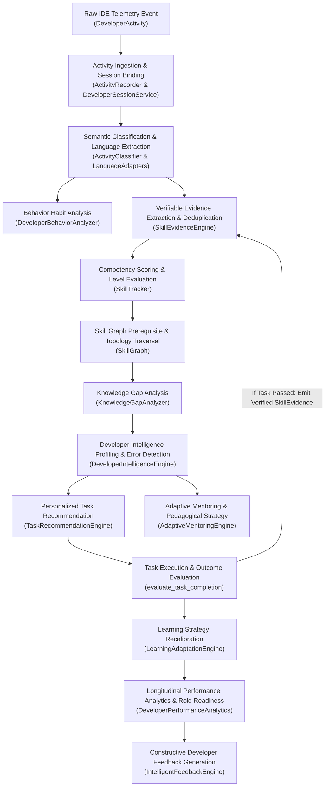

# PRISM Intelligence Pipeline: Complete Data Flow

> **Document Version:** 1.0.0  
> **Source Files Referenced:** `src/prism/intelligence/`, `src/prism/learning/`, `src/prism/mentoring/`, `src/prism/api/routes/`  

---

## 1. Verified End-to-End Pipeline Overview

The PRISM intelligence pipeline processes raw developer telemetry, refines it through semantic classification, evaluates verifiable skill artifacts against a directed skill graph, derives longitudinal competency trajectories, formulates personalized coding challenges, adjusts mentoring pedagogy, and delivers real-time constructive feedback.

The diagram below depicts the **verified runtime data flow** as executed by `CrossModuleIntelligenceOrchestrator` and the core engines:



---

## 2. Step-by-Step Data Flow Breakdown

### Step 1: Raw Activity Ingestion & Working Session Binding
* **Receiving Component:** `ActivityRecorder` (`src/prism/intelligence/developer_activity.py`) via `POST /activity/record`.
* **Input Data:** `DeveloperActivity` model:
  ```json
  {
    "event_id": "evt_abc123",
    "developer_id": "dev_deepak",
    "event_type": "file_save",
    "timestamp": "2026-11-05T10:00:00Z",
    "project_path": "/workspace/prism_core",
    "file_path": "/workspace/prism_core/storage/mysql.py",
    "metadata": {"language": "python", "lines_changed": 42}
  }
  ```
* **Processing:**
  1. Calls `DeveloperSessionService.get_active_session("dev_deepak")`.
  2. If an active session exists and is unexpired, binds `session_id` to the activity and touches the session heartbeat.
  3. If no active session exists or the previous session timed out, marks `session_id = None`.
  4. Persists the record via `ActivityRepository.save(activity)`.
* **Output:** Stored `DeveloperActivity` bound to an active session context.

---

### Step 2: Multi-Language Classification & Concept Extraction
* **Receiving Component:** `ActivityClassifier` (`src/prism/intelligence/activity_classifier.py`) and `LanguageAdapters` (`src/prism/intelligence/languages/`).
* **Input Data:** `DeveloperActivity` (file path, project structure, code changes, event type).
* **Processing:**
  1. Inspects file extension (`.py`, `.ts`, `.rs`, `.go`, `.java`, `.sql`).
  2. Selects the registered language adapter from `LanguageAdapterRegistry`.
  3. Extracts syntactic concepts (e.g., ORM models, async functions, SQL queries, REST endpoints, unit tests).
  4. Classifies the activity into technical domains: `backend`, `frontend`, `database`, `devops`, `testing`, `system`.
* **Output:** `ActivityClassificationResult` containing language metadata, matched concepts, and category labels.

---

### Step 3: Developer Behavior Pattern Analysis
* **Receiving Component:** `DeveloperBehaviorAnalyzer` (`src/prism/intelligence/developer_behavior_analyzer.py`).
* **Input Data:** Collection of `DeveloperActivity` records across active sessions.
* **Processing:**
  1. Computes testing discipline: `test_to_edit_ratio = test_runs / max(1, code_edits)`.
  2. Evaluates error resilience: calculates density of `syntax_error` and `runtime_error` events relative to total actions.
  3. Evaluates workspace exploration: counts distinct files touched and context switching frequency.
* **Output:** `DeveloperBehaviorInsights` capturing behavioral flags (e.g., `high_test_discipline`, `elevated_error_rate`, `broad_exploration`).

---

### Step 4: Verifiable Skill Evidence Extraction & Deduplication
* **Receiving Component:** `SkillEvidenceEngine` (`src/prism/intelligence/skill_evidence_engine.py`).
* **Input Data:** Classified `DeveloperActivity` and semantic concepts.
* **Processing:**
  1. Filters out non-evidential activities (e.g., trivial navigation, idle heartbeats).
  2. Computes SHA256 deduplication fingerprint across `(developer_id, skill_name, project_path, event_type)`.
  3. Computes `evidence_strength` (0.5 to 2.0) based on action significance (e.g., passing unit test execution = 2.0; file save = 0.5).
  4. Computes `complexity_score` and `confidence_score`.
* **Output:** Verified `SkillEvidence` object:
  ```python
  SkillEvidence(
      evidence_id="ev_98765",
      developer_id="dev_deepak",
      skill_name="SQLAlchemy",
      skill_id="sqlalchemy",
      evidence_type="test_pass",
      description="Passing unit test for SQLAlchemy 2.0 repository integration",
      evidence_source="code_artifact",
      evidence_strength=2.0,
      confidence_score=0.95,
      complexity_score=0.8,
      timestamp=datetime.now(UTC),
      project_path="/workspace/prism_core",
  )
  ```

---

### Step 5: Competency Scoring & Proficiency Progression
* **Receiving Component:** `SkillTracker` (`src/prism/intelligence/skill_tracker.py`).
* **Input Data:** `SkillEvidence` logged for the developer.
* **Processing:**
  1. Retrieves developer's `DeveloperSkillProfile` from `SkillRepository`.
  2. Appends new evidence to the skill's historical evidence list.
  3. Evaluates multi-factor competency score (0.0 to 100.0):
     $$\text{Score} = \text{QuantityScore} + \text{StrengthScore} + \text{ComplexityScore} + \text{DiversityScore} + \text{ConfidenceScore}$$
     * *Quantity with Diminishing Returns:* logarithmic scaling up to 25 points.
     * *Diversity:* counts distinct projects and diverse evidence types (commits, test passes, refactorings).
  4. Evaluates milestone level progression:
     * `count < 3`: `INSUFFICIENT_DATA`
     * `count >= 4`: `ELEMENTARY`
     * `count >= 6` AND `has_verified_artifact` (test pass / feature): `INTERMEDIATE`
     * `count >= 12` AND $\ge 2$ projects AND $\ge 2$ evidence types: `ADVANCED`
     * `count >= 20` AND $\ge 3$ projects AND total score $\ge 80.0$: `EXPERT`
* **Output:** Updated `DeveloperSkill` and persisted `DeveloperSkillProfile`.

---

### Step 6: Skill Graph Topology & Prerequisite Resolution
* **Receiving Component:** `SkillGraph` (`src/prism/intelligence/skill_graph.py`).
* **Input Data:** Skill identifiers and target career role names (e.g., `"Backend Developer"`).
* **Processing:**
  1. Traverses directed acyclic graph (DAG) structure.
  2. Resolves direct and transitive prerequisites (e.g., `Python` $\rightarrow$ `FastAPI` $\rightarrow$ `REST APIs`).
  3. Resolves career role requirements via `ROLE_SKILLS_MAP`.
* **Output:** Prerequisite chains, adjacent technical skills, and role skill profiles.

---

### Step 7: Knowledge Gap Detection
* **Receiving Component:** `KnowledgeGapAnalyzer` (`src/prism/learning/knowledge_gap_analyzer.py`).
* **Input Data:** Current `DeveloperSkillProfile` and target skill or role.
* **Processing:**
  1. Checks if prerequisites in the graph have been mastered by the developer.
  2. Detects missing skills (zero evidence recorded) with `severity="high"`.
  3. Detects under-proficient skills (evidence exists, but below intermediate threshold) with `severity="medium"`.
* **Output:** List of `SkillGap` objects identifying missing skills, current vs. required proficiency, and gap severity.

---

### Step 8: Developer Intelligence Synthesis & Trend Tracking
* **Receiving Component:** `DeveloperIntelligenceEngine` (`src/prism/intelligence/developer_intelligence_engine.py`).
* **Input Data:** Telemetry activity history, skill profile, active gaps.
* **Processing:**
  1. Computes skill trajectories (`SkillTrend`): evaluates growth velocity and marks direction as `IMPROVING`, `STABLE`, or `DECLINING`.
  2. Synthesizes structured insights (`DeveloperInsight`):
     * `STRENGTH`: Top verified competencies.
     * `GAP`: Critical prerequisite blockers.
     * `RECURRING_ERROR`: Detects syntax/runtime error clusters ($\ge 3$ errors = `MEDIUM`, $\ge 6$ errors = `HIGH` severity).
     * `GROWTH`: Observes overall learning pace.
  3. Assesses overall developer status (`excelling`, `learning`, `struggling`, `insufficient_data`).
* **Output:** Comprehensive `DeveloperIntelligenceProfile` with trends and insights.

---

### Step 9: Personalized Task Recommendation
* **Receiving Component:** `TaskRecommendationEngine` (`src/prism/intelligence/task_recommendation_engine.py`).
* **Input Data:** Actionable gaps from `KnowledgeGapAnalyzer` and verified skill levels.
* **Processing:**
  1. Filters out gaps for skills already mastered at intermediate or higher.
  2. Determines task difficulty matching current level:
     * `INSUFFICIENT_DATA` $\rightarrow$ `BEGINNER` (syntactical correctness).
     * `BEGINNER` $\rightarrow$ `ELEMENTARY` (feature implementation with error handling).
     * `INTERMEDIATE` $\rightarrow$ `INTERMEDIATE` (production-grade architectural integration).
  3. Generates title, description, acceptance criteria, estimated completion time, and initial status (`GENERATED`).
* **Output:** `PersonalizedTask` entities persisted to `personalized_tasks` table.

---

### Step 10: Task Execution & Bidirectional Feedback Loop
* **Receiving Component:** `TaskRecommendationEngine.evaluate_task_completion()`.
* **Input Data:** `task_id`, `success: bool`, `execution_notes: str`, `artifacts: list[str]`.
* **Processing:**
  1. Evaluates completion, records `TaskOutcome` in `task_outcomes` table.
  2. Updates task status to `COMPLETED` or `IN_PROGRESS`.
  3. **Critical Automated Feedback Loop:**
     ```python
     if success:
         # Automatically converts verified task pass into genuine SkillEvidence!
         evidence = SkillEvidence(
             evidence_id=f"ev_tsk_{uuid.uuid4().hex[:10]}",
             developer_id=task.developer_id,
             skill_name=task.target_skill,
             skill_id=task.target_skill.lower().replace(" ", "_"),
             evidence_type="project_feature",
             description=f"Completed practice task '{task.title}'",
             evidence_source="task_execution",
             evidence_strength=1.8,
             confidence_score=0.9,
             complexity_score=0.7,
             timestamp=datetime.now(UTC),
         )
         self.skill_tracker.record_evidence(evidence)
     ```
* **Output:** `TaskEvaluation` report. If passed, the developer's skill score rises immediately in `SkillTracker`, automatically shrinking the detected gap on the subsequent pass.

---

### Step 11: Pedagogical Learning Strategy Adaptation
* **Receiving Component:** `LearningAdaptationEngine` (`src/prism/learning/learning_adaptation_engine.py`).
* **Input Data:** Historical `TaskOutcome` records, error frequency.
* **Processing:**
  1. Computes recent task success rate: $\text{Rate} = \text{Passed} / \text{TotalTasks}$.
  2. Success rate $< 0.40$ ($\ge 3$ tasks) $\rightarrow$ Adapts strategy to `REMEDIATION`.
  3. Success rate $\ge 0.85$ ($\ge 4$ tasks) $\rightarrow$ Adapts strategy to `ACCELERATED`.
  4. Error events $\ge 5$ $\rightarrow$ Adapts strategy to `PRACTICE_INTENSIVE`.
* **Output:** Persisted `LearningAdaptation` record establishing the developer's current active pedagogical learning mode.

---

### Step 12: Adaptive Mentoring Guidance
* **Receiving Component:** `AdaptiveMentoringEngine` (`src/prism/mentoring/adaptive_engine.py`).
* **Input Data:** Developer query, target skill, current profile, active strategy.
* **Processing:**
  1. Selects pedagogical strategy:
     * Debugging query keywords ("error", "bug", "traceback") $\rightarrow$ `DEBUGGING_GUIDANCE`.
     * Practice keywords ("exercise", "practice", "build") $\rightarrow$ `PRACTICAL_EXERCISE`.
     * Target skill in active gaps $\rightarrow$ `STEP_BY_STEP_LEARNING`.
     * Target skill proficient $\rightarrow$ `ADVANCED_TECHNICAL_GUIDANCE`.
  2. Adjusts explanation complexity (`foundational`, `targeted`, `advanced`).
  3. Suggests follow-up practice tasks from `TaskRecommendationEngine`.
  4. Persists session record in `mentoring_sessions` and updates `MentoringEffectiveness`.
* **Output:** `AdaptiveMentorResponse` providing tailored code guidance, structured steps, and practice recommendations.

---

### Step 13: Longitudinal Performance Analytics & Snapshots
* **Receiving Component:** `DeveloperPerformanceAnalytics` (`src/prism/intelligence/performance_analytics.py`).
* **Input Data:** Profile, task outcomes, activity metrics, learning progress.
* **Processing:**
  1. Computes verified skill count, average proficiency, task success rate, learning consistency.
  2. Evaluates career role readiness: calculates percentage match against required role skills.
  3. Creates an immutable point-in-time `DeveloperPerformanceSnapshot` record in `developer_performance_snapshots`.
* **Output:** `DeveloperPerformanceSnapshot` and `PerformanceOverviewResponse`.

---

### Step 14: Constructive Developer Feedback
* **Receiving Component:** `IntelligentFeedbackEngine` (`src/prism/intelligence/intelligent_feedback_engine.py`).
* **Input Data:** Post-task outcomes, recent performance trends, error telemetry.
* **Processing:**
  1. Follows a **strength-first constructive pedagogy**: acknowledges demonstrated strengths before pointing out weaknesses.
  2. Generates prioritized, actionable next steps.
  3. Persists feedback in `developer_feedbacks` table.
* **Output:** `DeveloperFeedback` delivering contextual encouragement and clear learning directions.
