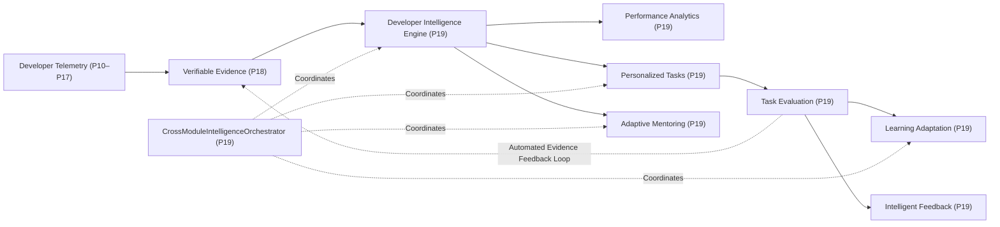

# Phase 19 Deep Architecture: Advanced Developer Intelligence & Adaptive Mentoring

> **Document Version:** 1.0.0  
> **Source Files Referenced:** `src/prism/intelligence/`, `src/prism/mentoring/`, `src/prism/learning/`, `src/prism/storage/`  

---

## 1. Overview of Phase 19 Evolution

Phases 1–18 established the data collection, syntax parsing, skill graph topology, and persistence foundations of PRISM. However, the system remained primarily an **observational registry**; it recorded what developers did, but did not actively tailor its teaching or guide the developer's growth.

**Phase 19 transforms PRISM into an active, adaptive learning system.** It introduces an autonomous feedback loop:



---

## 2. Component Deep Dive

### 2.1 Developer Intelligence Engine
* **Source File:** `src/prism/intelligence/developer_intelligence_engine.py`
* **Purpose:** Synthesizes disparate activity telemetry, verified skill levels, recurring error patterns, and learning velocity into an actionable developer profile.
* **Core Responsibilities:**
  1. Computes longitudinal competency trajectories (`SkillTrend`) across all tracked skills.
  2. Detects error spikes in activity streams (`syntax_error`, `runtime_error`).
  3. Synthesizes structured `DeveloperInsight` records categorized by `STRENGTH`, `GAP`, `RECURRING_ERROR`, `VELOCITY_SLOWDOWN`, and `GROWTH`.
  4. Classifies developer overall status: `excelling`, `learning`, `struggling`, `active`, or `insufficient_data`.
* **Important Classes & Functions:**
  * `DeveloperIntelligenceEngine.__init__(intelligence_repo, skill_tracker, activity_repo, gap_analyzer)`
  * `analyze_developer(developer_id: str) -> IntelligenceAnalysisResult`
  * `get_profile(developer_id: str) -> DeveloperIntelligenceProfile`
  * `get_insights(developer_id: str, category: InsightCategory | None) -> list[DeveloperInsight]`
  * `get_skill_trends(developer_id: str) -> list[SkillTrend]`
* **Inputs & Outputs:**
  * *Input:* `developer_id: str`
  * *Output:* `IntelligenceAnalysisResult` containing `DeveloperIntelligenceProfile`, `list[DeveloperInsight]`, and `list[SkillTrend]`.
* **Dependencies on Other Modules:**
  * `SkillTracker`: To read the developer's verified skills and evidence.
  * `ActivityRepository`: To inspect recent developer activities and error counts.
  * `KnowledgeGapAnalyzer`: To evaluate active knowledge gaps.
  * `IntelligenceRepository`: To persist generated insights and retrieved cached profiles.
* **Database Communication:**
  * Queries `developer_activities` for events in the active window.
  * Persists generated insights to `developer_insights` using `save_insight()`.
* **Practical Example:**
  ```python
  engine = DeveloperIntelligenceEngine(intel_repo, skill_tracker, act_repo, gap_analyzer)
  result = engine.analyze_developer("dev_007")

  print(result.profile.overall_status)  # "struggling"
  for insight in result.insights:
      if insight.category == InsightCategory.RECURRING_ERROR:
          print(f"Alert: {insight.title} -> {insight.actionable_recommendation}")
          # Output: Alert: Recurring Execution or Syntax Errors Detected -> Consider step-by-step debugging guidance
  ```

---

### 2.2 Adaptive Mentoring Engine
* **Source File:** `src/prism/mentoring/adaptive_engine.py`
* **Purpose:** Provides personalized, strategy-driven mentoring that dynamically adapts its pedagogical style to the developer's experience level, current goals, and active skill gaps.
* **Core Responsibilities:**
  1. Dynamically selects from six distinct mentoring strategies (`MentoringStrategy`):
     * `CONCEPTUAL_EXPLANATION`: Foundational principles for beginner concepts.
     * `GUIDED_IMPLEMENTATION`: Standard step-by-step coding guidance.
     * `DEBUGGING_GUIDANCE`: Root-cause diagnosis and reproduction steps for error queries.
     * `STEP_BY_STEP_LEARNING`: Micro-steps targeting unresolved prerequisite gaps.
     * `PRACTICAL_EXERCISE`: Hands-on challenges for active skill practice.
     * `ADVANCED_TECHNICAL_GUIDANCE`: Architecture, concurrency, and performance tuning for senior competencies.
  2. Adapts explanation complexity (`foundational`, `targeted`, `advanced`).
  3. Recommends follow-up practice tasks from `TaskRecommendationEngine`.
  4. Computes quantitative `MentoringEffectiveness` scores (0.0 to 1.0) correlating mentoring sessions with upward skill trajectories.
* **Important Classes & Functions:**
  * `AdaptiveMentoringEngine.__init__(intelligence_repo, base_mentor_engine, intelligence_engine, task_engine)`
  * `request_adaptive_mentoring(request: AdaptiveMentorRequest) -> AdaptiveMentorResponse`
  * `get_session_history(developer_id: str, limit: int) -> list[MentoringSessionRecord]`
  * `get_mentoring_effectiveness(developer_id: str) -> MentoringEffectiveness`
  * `_select_strategy(query, target_skill, profile) -> MentoringStrategy`
* **Inputs & Outputs:**
  * *Input:* `AdaptiveMentorRequest(developer_id="dev_007", query="Why is my SQLAlchemy query timing out?", target_skill="SQLAlchemy")`
  * *Output:* `AdaptiveMentorResponse(selected_strategy=DEBUGGING_GUIDANCE, explanation_complexity="targeted", actionable_steps=[...], suggested_task=PersonalizedTask(...))`
* **Dependencies on Other Modules:**
  * `MentoringEngine`: Reuses base deterministic prompt generation and context builder.
  * `DeveloperIntelligenceEngine`: To inspect the developer's profile and active gaps.
  * `TaskRecommendationEngine`: To attach a relevant coding exercise to the mentoring advice.
  * `IntelligenceRepository`: To record session history in `mentoring_sessions`.
* **Database Communication:**
  * Persists session metadata (`session_id`, `strategy`, `query`, `summary`) into `mentoring_sessions` via `save_mentoring_session()`.
  * Queries historical sessions via `get_mentoring_sessions()`.
* **Practical Example:**
  When a developer with beginner knowledge in Docker asks *"How do I scale containers?"*, the engine detects Docker as an active foundational gap, overrides the generic response, and selects `STEP_BY_STEP_LEARNING` at `foundational` complexity, guiding them through basic containerization before introducing cluster orchestration.

---

### 2.3 Personalized Task Recommendation Engine
* **Source File:** `src/prism/intelligence/task_recommendation_engine.py`
* **Purpose:** Formulates actionable, bite-sized practice coding tasks targeted specifically at resolving detected competency gaps.
* **Core Responsibilities:**
  1. Identifies missing prerequisites using `KnowledgeGapAnalyzer`.
  2. Filters out skills already mastered at `INTERMEDIATE`, `ADVANCED`, or `EXPERT` levels.
  3. Calibrates task difficulty (`BEGINNER`, `ELEMENTARY`, `INTERMEDIATE`, `ADVANCED`) matching the developer's current competence.
  4. Generates structured tasks with clear acceptance criteria and time estimates.
  5. **Automated Evidence Feedback Loop:** Upon successful task completion (`evaluate_task_completion`), automatically creates and records verified `SkillEvidence` into `SkillTracker`, directly updating the developer's proficiency.
* **Important Classes & Functions:**
  * `TaskRecommendationEngine.__init__(skill_tracker, gap_analyzer, skill_graph, intelligence_repo)`
  * `generate_tasks(developer_id, target_role, target_goal, limit) -> list[TaskRecommendation]`
  * `get_task(task_id: str) -> PersonalizedTask | None`
  * `update_task_status(task_id: str, new_status: str, notes: str) -> PersonalizedTask`
  * `evaluate_task_completion(task_id, success, execution_notes, artifacts) -> TaskEvaluation`
* **Inputs & Outputs:**
  * *Input (Task Generation):* `developer_id="dev_007", target_role="Backend Developer"`
  * *Output (Task Generation):* `list[TaskRecommendation]` wrapping `PersonalizedTask` entities.
  * *Input (Task Evaluation):* `task_id="tsk_123", success=True, execution_notes="Implemented all tests", artifacts=["test_api.py"]`
  * *Output (Task Evaluation):* `TaskEvaluation(score=85.0, passed=True, generated_evidence_id="ev_tsk_...")`
* **Dependencies on Other Modules:**
  * `KnowledgeGapAnalyzer`: To discover missing prerequisites.
  * `SkillGraph`: To inspect skill metadata and prerequisites.
  * `SkillTracker`: To inspect current levels and record new evidence upon task completion.
  * `IntelligenceRepository`: To persist tasks (`personalized_tasks`) and outcomes (`task_outcomes`).
* **Database Communication:**
  * Stores task definitions in `personalized_tasks`.
  * Stores evaluation outcomes in `task_outcomes`.

---

### 2.4 Developer Performance Analytics
* **Source File:** `src/prism/intelligence/performance_analytics.py`
* **Purpose:** Computes comprehensive multi-dimensional performance metrics, career role readiness ratings, and longitudinal progress snapshots.
* **Core Responsibilities:**
  1. Computes aggregate competency metrics (verified skills count, average proficiency score, active gaps count).
  2. Computes career **Role Readiness Indicators** (e.g., *Backend Developer*, *Full Stack Developer*, *Machine Learning Engineer*):
     $$\text{ReadinessPercentage} = \left(\frac{\text{MasteredRequiredSkills}}{\text{TotalRequiredSkills}}\right) \times 100$$
  3. Measures longitudinal skill improvement velocity.
  4. Persists immutable point-in-time `DeveloperPerformanceSnapshot` records.
* **Important Classes & Functions:**
  * `DeveloperPerformanceAnalytics.__init__(intelligence_engine, skill_tracker, skill_graph, intelligence_repo, learning_repo, activity_repo)`
  * `get_overview(developer_id: str) -> PerformanceOverviewResponse`
  * `get_skill_improvement(developer_id: str) -> SkillImprovementResponse`
  * `get_learning_progress(developer_id: str) -> LearningProgressResponse`
  * `get_historical_snapshots(developer_id, limit, offset) -> list[DeveloperPerformanceSnapshot]`
* **Inputs & Outputs:**
  * *Input:* `developer_id: str`
  * *Output:* `PerformanceOverviewResponse` (readiness percentages, mastered skills, missing skills, task completion velocity).
* **Dependencies on Other Modules:**
  * `DeveloperIntelligenceEngine`: To inspect the developer profile.
  * `SkillTracker`: To evaluate skill proficiency levels.
  * `SkillGraph`: To retrieve required skills for each career role.
  * `IntelligenceRepository`: To persist and retrieve historical snapshots.
* **Database Communication:**
  * Persists snapshots into `developer_performance_snapshots` via `save_snapshot()`.
  * Queries historical snapshots via `get_snapshots()`.

---

### 2.5 Intelligent Feedback Engine
* **Source File:** `src/prism/intelligence/intelligent_feedback_engine.py`
* **Purpose:** Produces contextual, strength-first constructive feedback for developers after task completions or upon detecting persistent friction in telemetry.
* **Core Responsibilities:**
  1. Enforces **constructive pedagogical framing**: always highlights demonstrated strengths before providing corrective recommendations.
  2. Generates task-specific feedback after evaluation.
  3. Emits proactive feedback when error events or slowdowns are detected in active sessions.
  4. Categorizes feedback into `PRAISE`, `CORRECTIVE`, `STRATEGIC`, and `MOTIVATIONAL`.
* **Important Classes & Functions:**
  * `IntelligentFeedbackEngine.__init__(intelligence_repo, intelligence_engine)`
  * `generate_feedback_for_task(developer_id, task, outcome) -> DeveloperFeedback`
  * `generate_proactive_feedback(developer_id) -> list[DeveloperFeedback]`
  * `get_feedback_history(developer_id, limit) -> list[DeveloperFeedback]`
* **Inputs & Outputs:**
  * *Input:* `developer_id: str`, `task: PersonalizedTask`, `outcome: TaskOutcome`
  * *Output:* `DeveloperFeedback(category=PRAISE, title="Strong Task Execution", message="...", actionable_steps=[...])`
* **Dependencies on Other Modules:**
  * `DeveloperIntelligenceEngine`: To understand profile trends and strengths.
  * `IntelligenceRepository`: To store and query feedback records in `developer_feedbacks`.
* **Database Communication:**
  * Persists feedback records into `developer_feedbacks` via `save_feedback()`.

---

### 2.6 Learning Adaptation Engine
* **Source File:** `src/prism/learning/learning_adaptation_engine.py`
* **Purpose:** Recalibrates pedagogical learning strategies based on empirical task pass/fail rates and developer performance velocity.
* **Core Responsibilities:**
  1. Analyzes task outcome history from `IntelligenceRepository`.
  2. Dynamically shifts between five learning strategies (`LearningStrategyType`):
     * `STANDARD`: Balanced pace for steady progress.
     * `REMEDIATION`: Triggered when success rate $< 40\%$ ($\ge 3$ tasks); simplifies tasks and breaks concepts into prerequisite sub-skills.
     * `ACCELERATED`: Triggered when success rate $\ge 85\%$ ($\ge 4$ tasks); increases task difficulty and skips intermediate steps.
     * `PRACTICE_INTENSIVE`: Triggered by high error frequency ($\ge 5$ errors); focuses on repeated hands-on unit tests.
     * `PREREQUISITE_FIRST`: Triggered when deep dependency gaps block progress.
  3. Persists adaptation records and rationale.
* **Important Classes & Functions:**
  * `LearningAdaptationEngine.__init__(intelligence_repo, intelligence_engine, gap_analyzer)`
  * `adapt_strategy(developer_id: str) -> LearningAdaptation`
  * `get_current_strategy(developer_id: str) -> LearningAdaptation`
  * `get_adaptation_history(developer_id, limit) -> list[LearningAdaptation]`
* **Inputs & Outputs:**
  * *Input:* `developer_id: str`
  * *Output:* `LearningAdaptation(previous_strategy=STANDARD, new_strategy=REMEDIATION, reason="Low task completion rate (33.3%)", trigger_metrics={...})`
* **Dependencies on Other Modules:**
  * `IntelligenceRepository`: To query task outcomes and persist adaptation logs.
  * `DeveloperIntelligenceEngine`: To inspect error telemetry.
* **Database Communication:**
  * Queries `task_outcomes` to calculate success rates.
  * Persists adaptation transitions into `learning_adaptations` via `save_adaptation()`.

---

### 2.7 Cross-Module Intelligence Orchestrator
* **Source File:** `src/prism/intelligence/intelligence_orchestrator.py`
* **Purpose:** The single central coordinator that orchestrates the end-to-end reactive cycle connecting telemetry ingestion, evidence collection, profiling, gap detection, task generation, and pedagogical adaptation.
* **Core Responsibilities:**
  1. `process_activity_and_recalibrate(activity: DeveloperActivity)`:
     * Ingests the raw event.
     * Checks session validity with `DeveloperSessionService`.
     * Extracts verifiable evidence via `SkillEvidenceEngine` and updates `SkillTracker`.
     * Re-runs `DeveloperIntelligenceEngine.analyze_developer()`.
     * Emits proactive feedback via `IntelligentFeedbackEngine` if error spikes are detected.
  2. `run_full_developer_sync(developer_id: str, target_role: str | None)`:
     * Executes end-to-end synchronization across all subsystems.
     * Recalculates skill profile, re-identifies knowledge gaps, generates fresh personalized tasks, adapts the learning strategy, updates performance analytics, and emits feedback.
* **Important Classes & Functions:**
  * `CrossModuleIntelligenceOrchestrator.__init__(...)`
  * `process_activity_and_recalibrate(activity: DeveloperActivity) -> dict[str, Any]`
  * `run_full_developer_sync(developer_id, target_role) -> dict[str, Any]`
* **Inputs & Outputs:**
  * *Input:* `DeveloperActivity` or `developer_id`
  * *Output:* Structured status summary confirming execution status, recorded evidence IDs, and active strategies.
* **Dependencies on Other Modules:**
  * Connects `ActivityRepository`, `SkillEvidenceEngine`, `SkillTracker`, `KnowledgeGapAnalyzer`, `DeveloperIntelligenceEngine`, `PerformanceAnalytics`, `TaskRecommendationEngine`, `IntelligentFeedbackEngine`, and `LearningAdaptationEngine`.
