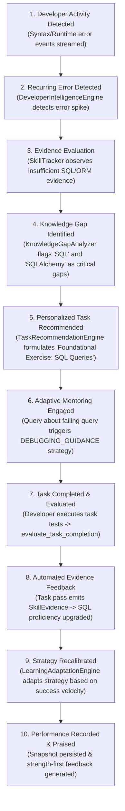

# PRISM System Architecture

> **Document Version:** 1.0.0  
> **Target Audience:** Core Contributors, Software Architects, Technical Interviewers, and Platform Engineers  
> **Source Files Referenced:** `src/prism/api/`, `src/prism/context/`, `src/prism/intelligence/`, `src/prism/learning/`, `src/prism/mentoring/`, `src/prism/storage/`  

---

## 1. High-Level Architecture Topology

PRISM is organized as a decoupled, multi-layered reactive system. The diagram below represents the exact structural topology, component communication boundaries, and persistence bridges as implemented in the codebase.

```mermaid
graph TD
    subgraph Client_Layer ["Client & Ingestion Layer"]
        IDE["IDE Plugin / Extensions (VS Code, JetBrains)"]
        CLI["PRISM CLI & Developer Tools"]
        GIT["Git Webhooks / Commit Hooks"]
    end

    subgraph API_Layer ["API & Interface Layer (FastAPI)"]
        direction TB
        MainApp["FastAPI Main Application (src/prism/api/main.py)"]
        
        R_Dev["Developer Router (/developer)"]
        R_Sess["Session Router (/session)"]
        R_Act["Activity Router (/activity)"]
        R_Proj["Project Router (/projects)"]
        R_Skill["Skills Router (/skills)"]
        R_Learn["Learning Router (/learning)"]
        R_Mentor["Mentoring Router (/mentoring)"]
        R_Intel["Intelligence Router (/intelligence)"]
        R_Task["Tasks Router (/tasks)"]
        R_Analytics["Analytics Router (/analytics)"]
        R_Feed["Feedback Router (/feedback)"]
        R_Adapt["Adaptation Router (/adaptation)"]
    end

    subgraph DI_Layer ["Dependency Injection & Service Wiring"]
        Deps["src/prism/api/dependencies.py"]
    end

    subgraph Context_Layer ["Project Context & Code Intelligence"]
        Scanner["ProjectScanner (src/prism/context/project_scanner.py)"]
        CodeAnalyzer["CodeAnalyzer (src/prism/context/code_analyzer.py)"]
        DepAnalyzer["DependencyAnalyzer (src/prism/intelligence/dependency_analyzer.py)"]
        CodeRel["CodeRelationshipAnalyzer (src/prism/intelligence/code_relationships.py)"]
        ProjIntel["ProjectIntelligenceService (src/prism/intelligence/project_intelligence.py)"]
    end

    subgraph Activity_Layer ["Activity & Behavior Intelligence"]
        ActService["DeveloperActivityIntelligenceService (src/prism/intelligence/activity_intelligence_service.py)"]
        ActRecorder["ActivityRecorder (src/prism/intelligence/developer_activity.py)"]
        ActClassifier["ActivityClassifier (src/prism/intelligence/activity_classifier.py)"]
        ActAggregator["ActivityAggregationEngine (src/prism/intelligence/activity_aggregation_engine.py)"]
        SessAnalyzer["ActivitySessionAnalyzer (src/prism/intelligence/activity_session_analyzer.py)"]
        BehavAnalyzer["DeveloperBehaviorAnalyzer (src/prism/intelligence/developer_behavior_analyzer.py)"]
    end

    subgraph Identity_Layer ["Identity & Session Management"]
        IdService["DeveloperIdentityService (src/prism/intelligence/developer_identity.py)"]
        SessService["DeveloperSessionService (src/prism/intelligence/developer_session.py)"]
    end

    subgraph Skill_Layer ["Skill Graph & Competency Tracking"]
        SkillGraph["SkillGraph DAG (src/prism/intelligence/skill_graph.py)"]
        SkillTracker["SkillTracker (src/prism/intelligence/skill_tracker.py)"]
        SkillEvidenceEng["SkillEvidenceEngine (src/prism/intelligence/skill_evidence_engine.py)"]
    end

    subgraph Learning_Layer ["Learning Intelligence"]
        GapAnalyzer["KnowledgeGapAnalyzer (src/prism/learning/knowledge_gap_analyzer.py)"]
        RecEngine["LearningRecommendationEngine (src/prism/learning/recommendation_engine.py)"]
        PathGen["LearningPathGenerator (src/prism/learning/learning_path_generator.py)"]
        ProgTracker["LearningProgressTracker (src/prism/learning/progress_tracker.py)"]
    end

    subgraph Phase19_Layer ["Phase 19: Advanced Developer Intelligence & Adaptive Systems"]
        DevIntel["DeveloperIntelligenceEngine (src/prism/intelligence/developer_intelligence_engine.py)"]
        AdaptiveMentor["AdaptiveMentoringEngine (src/prism/mentoring/adaptive_engine.py)"]
        TaskRec["TaskRecommendationEngine (src/prism/intelligence/task_recommendation_engine.py)"]
        PerfAnalytics["DeveloperPerformanceAnalytics (src/prism/intelligence/performance_analytics.py)"]
        FeedEngine["IntelligentFeedbackEngine (src/prism/intelligence/intelligent_feedback_engine.py)"]
        AdaptEngine["LearningAdaptationEngine (src/prism/learning/learning_adaptation_engine.py)"]
        Orchestrator["CrossModuleIntelligenceOrchestrator (src/prism/intelligence/intelligence_orchestrator.py)"]
    end

    subgraph Base_Mentoring ["Base Mentoring Subsystem"]
        BaseMentor["MentoringEngine (src/prism/mentoring/engine.py)"]
        ContextBuilder["MentorContextBuilder (src/prism/mentoring/context_builder.py)"]
        Generator["DeterministicMentorGenerator (src/prism/mentoring/response_generator.py)"]
    end

    subgraph Storage_Layer ["Storage & Repository Layer (src/prism/storage/)"]
        Protocols["Repository Protocols (src/prism/storage/repositories/base.py)"]
        MemRepo["In-Memory Repositories (src/prism/storage/repositories/memory_repo.py)"]
        MySQLRepo["MySQL Repositories (src/prism/storage/repositories/mysql_*_repo.py)"]
        DBEngine["SQLAlchemy 2.0 Engine & SessionFactory (src/prism/storage/database.py)"]
        MySQLDB[("MySQL 8.0+ Database (utf8mb4_0900_ai_ci)")]
    end

    %% Client to API
    IDE & CLI & GIT -->|HTTP / REST JSON| MainApp
    MainApp --> R_Dev & R_Sess & R_Act & R_Proj & R_Skill & R_Learn & R_Mentor & R_Intel & R_Task & R_Analytics & R_Feed & R_Adapt

    %% DI Wiring
    Deps -.->|Instantiates & Injects| Identity_Layer
    Deps -.->|Instantiates & Injects| Activity_Layer
    Deps -.->|Instantiates & Injects| Skill_Layer
    Deps -.->|Instantiates & Injects| Learning_Layer
    Deps -.->|Instantiates & Injects| Base_Mentoring
    Deps -.->|Instantiates & Injects| Phase19_Layer
    Deps -.->|Wires Storage| Storage_Layer

    %% Runtime Communications
    R_Act --> ActRecorder & ActService
    ActRecorder --> SessService
    ActService --> ActClassifier & ActAggregator & SessAnalyzer

    %% Orchestrator connections
    R_Intel --> Orchestrator & DevIntel
    Orchestrator --> ActRecorder
    Orchestrator --> SkillEvidenceEng
    Orchestrator --> DevIntel
    Orchestrator --> PerfAnalytics
    Orchestrator --> TaskRec
    Orchestrator --> FeedEngine
    Orchestrator --> AdaptEngine

    %% Skill & Evidence
    SkillEvidenceEng --> SkillTracker
    SkillTracker --> SkillGraph
    GapAnalyzer --> SkillGraph
    GapAnalyzer --> SkillTracker

    %% Phase 19 Engine Connections
    DevIntel --> SkillTracker
    DevIntel --> GapAnalyzer
    TaskRec --> GapAnalyzer
    TaskRec --> SkillGraph
    TaskRec --> SkillTracker
    TaskRec -.->|On Task Pass: Emits SkillEvidence| SkillTracker

    PerfAnalytics --> DevIntel
    PerfAnalytics --> SkillTracker
    PerfAnalytics --> SkillGraph

    AdaptiveMentor --> BaseMentor
    AdaptiveMentor --> DevIntel
    AdaptiveMentor --> TaskRec

    FeedEngine --> DevIntel
    AdaptEngine --> DevIntel
    AdaptEngine --> GapAnalyzer

    %% Base Mentoring
    BaseMentor --> ContextBuilder
    ContextBuilder --> SkillTracker & BehavAnalyzer & GapAnalyzer & PathGen & ActRecorder
    BaseMentor --> Generator

    %% Storage Bridge
    IdService & SessService & ActRecorder & SkillTracker & ProgTracker & DevIntel & TaskRec & AdaptiveMentor & FeedEngine & AdaptEngine --> Protocols
    Protocols <|.. MemRepo
    Protocols <|.. MySQLRepo
    MySQLRepo --> DBEngine
    DBEngine --> MySQLDB
```

---

## 2. Architectural Layers & Component Responsibilities

PRISM is partitioned into strict horizontal layers. Each layer has an explicit mandate and interacts only with authorized adjacent layers.

### 2.1 API Layer (`src/prism/api/`)
* **Role:** The HTTP interface exposing PRISM's capabilities to external clients (IDE extensions, web dashboards, CLI tools).
* **Implementation:** Built with FastAPI (`src/prism/api/main.py`), utilizing Pydantic V2 models with `extra="forbid"` for strict payload validation.
* **Routers (12 Modules):**
  1. `project.py`: Project AST scanning and structural intelligence.
  2. `developer.py`: Developer registration, profile retrieval, behavior telemetry analysis.
  3. `session.py`: IDE working session lifecycle (start, heartbeat, end, history).
  4. `activity.py`: Multi-language activity event ingestion, batch recording, metrics, language breakdowns.
  5. `skills.py`: Verifiable evidence ingestion, proficiency queries, graph topology, gap analysis, and learning roadmaps.
  6. `learning.py`: Direct knowledge gap, recommendation, and path endpoints.
  7. `mentoring.py`: Multi-modal build/learn mentoring and Phase 19 adaptive mentoring sessions.
  8. `intelligence.py`: Developer intelligence profiles, categorized insights, skill trends, and orchestrator triggers.
  9. `tasks.py`: Personalized practice task generation, lifecycle transitions, and completion evaluation.
  10. `analytics.py`: Longitudinal performance overviews, role readiness indicators, and snapshot histories.
  11. `feedback.py`: Proactive and post-task feedback queries.
  12. `adaptation.py`: Pedagogical learning strategy adjustments and history tracking.

### 2.2 Dependency Injection Layer (`src/prism/api/dependencies.py`)
* **Role:** Composition root responsible for service instantiation, storage backend selection, and lifecycle management.
* **Design Philosophy:** Guarantees that neither API routes nor domain engines directly instantiate database sessions or repositories.
* **Mechanism:**
  * Checks `settings.storage_backend`. If `mysql`, initializes `MySQL*Repository` instances connected via SQLAlchemy session factories. If `memory`, initializes `InMemory*Repository` instances.
  * Provides dependency getter functions (`get_skill_tracker()`, `get_intelligence_engine()`, `get_intelligence_orchestrator()`) consumed by FastAPI route functions via `fastapi.Depends`.

### 2.3 Project Context & Code Intelligence (`src/prism/context/`)
* **Role:** Static analysis of developer codebases without executing code.
* **Key Components:**
  * `ProjectScanner`: Traverses project file hierarchies, respecting ignore rules (`.gitignore`, `.git`, virtual environments).
  * `CodeAnalyzer`: Uses Python's native `ast` library to parse module structures, extracting classes, methods, docstrings, and syntax trees.
  * `DependencyAnalyzer`: Resolves internal module imports and third-party package dependencies (e.g., `fastapi`, `pydantic`, `sqlalchemy`).
  * `CodeRelationshipAnalyzer`: Constructs bidirectional code dependency graphs (calls, inheritances, imports).

### 2.4 Developer Activity Intelligence (`src/prism/intelligence/`)
* **Role:** Captures, classifies, and normalizes raw IDE telemetry events.
* **Key Components:**
  * `ActivityRecorder`: Receives raw `DeveloperActivity` objects, associates them with the active session, and commits them to `ActivityRepository`.
  * `ActivityClassifier`: Maps file extensions and AST hints to technical categories (e.g., backend, database, testing, frontend).
  * `LanguageAdapters` (`src/prism/intelligence/languages/`): Pluggable adapters extracting technical concepts for Python, TypeScript, Go, Rust, Java, C++, Ruby, etc.
  * `ActivityAggregationEngine`: Computes real-time event distributions across languages and editing categories.
  * `ActivitySessionAnalyzer`: Derives duration, active vs. idle time, and burst vs. sustained working rhythms.

### 2.5 Developer Behavior Intelligence (`src/prism/intelligence/developer_behavior_analyzer.py`)
* **Role:** Identifies development working habits and psychological work patterns.
* **Key Outputs:**
  * Computes testing discipline (test-to-edit ratio, test failure rate).
  * Measures error frequency (syntax and runtime error density).
  * Measures context switching (file hopping velocity and active workspace footprint).

### 2.6 Developer Identity & Working Sessions (`src/prism/intelligence/developer_identity.py`, `developer_session.py`)
* **Role:** Enforces consistent developer identification and working session state management.
* **Key Behaviors:**
  * Maintains unique developer records (`developer_id`, email, name).
  * Enforces session heartbeat timeouts (`session_timeout_minutes`).
  * Automatically handles session expiration, heartbeats, and graceful terminations.

### 2.7 Skill Graph & Skill Tracking (`src/prism/intelligence/skill_graph.py`, `skill_tracker.py`)
* **Role:** Verifiable competency tracking grounded in concrete technical evidence.
* **Key Components:**
  * `SkillGraph`: In-memory directed acyclic graph (DAG) representing technical skills (`SkillNode`) and dependencies (`prerequisite`, `related`, `specialization_of`).
  * `SkillTracker`: Manages developer competencies (`DeveloperSkill`). Evaluates scores (0–100) using a multi-factor formula (volume with diminishing returns, evidence strength, task complexity, project diversity, and observation confidence) transitioning skills across `insufficient_data`, `beginner`, `elementary`, `intermediate`, `advanced`, and `expert`.
  * `SkillEvidenceEngine`: Deduplicates incoming activities, generates SHA256 hashes, filters non-evidential events, and converts verified tasks into permanent `SkillEvidence`.

### 2.8 Learning Intelligence (`src/prism/learning/`)
* **Role:** Gap detection and pedagogical pathway synthesis.
* **Key Components:**
  * `KnowledgeGapAnalyzer`: Compares developer profiles against `SkillGraph` nodes or career role profiles, identifying missing prerequisites and under-proficient competencies.
  * `LearningRecommendationEngine`: Prioritizes gaps (`CRITICAL`, `HIGH`, `MEDIUM`, `LOW`) with effort estimations.
  * `LearningPathGenerator`: Performs cycle-safe topological sorting to construct ordered learning sequences.
  * `LearningProgressTracker`: Tracks acquired vs. remaining milestones along active pathways.

### 2.9 Base Mentoring Engine (`src/prism/mentoring/`)
* **Role:** Context-aware explanation and technical guidance.
* **Key Components:**
  * `MentorContextBuilder`: Gathers current code context, behavior telemetry, skill levels, and active gaps into a unified `MentorContext`.
  * `MentoringEngine`: Generates structured responses in **Build Mode** (architecture, dependencies, test stability) or **Learn Mode** (concept explanations, step-by-step guides).
  * `DeterministicMentorGenerator`: Template-driven generator guaranteeing reproducible, provider-independent advice without external API dependencies.

### 2.10 Phase 19: Advanced Developer Intelligence & Adaptive Mentoring
* **`DeveloperIntelligenceEngine`**: Aggregates profile state, trends, and recurring errors into structured insights (`STRENGTH`, `GAP`, `RECURRING_ERROR`, `VELOCITY_SLOWDOWN`, `GROWTH`).
* **`AdaptiveMentoringEngine`**: Selects dynamic pedagogical strategies (`CONCEPTUAL_EXPLANATION`, `GUIDED_IMPLEMENTATION`, `DEBUGGING_GUIDANCE`, `STEP_BY_STEP_LEARNING`, `PRACTICAL_EXERCISE`, `ADVANCED_TECHNICAL_GUIDANCE`) and computes quantified effectiveness.
* **`TaskRecommendationEngine`**: Formulates targeted coding exercises with acceptance criteria and difficulty scaling.
* **`DeveloperPerformanceAnalytics`**: Generates historical snapshots and career role readiness ratings.
* **`IntelligentFeedbackEngine` & `LearningAdaptationEngine`**: Emits constructive advice and recalibrates learning speeds.
* **`CrossModuleIntelligenceOrchestrator`**: Coordinates the entire reactive pipeline.

### 2.11 Storage Layer (`src/prism/storage/`)
* **Role:** Abstracted persistence boundary providing 100% functional parity between memory and relational database engines.
* **Key Components:**
  * Repository Protocols (`src/prism/storage/repositories/base.py`): Typed Python `Protocol` classes for `DeveloperRepository`, `ActivityRepository`, `SkillRepository`, `SkillGraphRepository`, `LearningRepository`, `DeveloperSessionRepository`, and `IntelligenceRepository`.
  * Dual Implementations:
    * `InMemory*Repository` (`memory_repo.py`): Thread-safe dictionaries for rapid, isolated unit testing.
    * `MySQL*Repository` (`mysql_*_repo.py`): SQLAlchemy 2.0 transactional implementations targeting MySQL 8.0+.
  * Database Engine (`database.py`): Configures connection pooling, connection recycling (`pool_recycle=3600`), and scoped session management.

---

## 3. Global Component Communication Topology

PRISM follows four strict communication rules to preserve architectural integrity:

1. **Downstream Invocation Only:** Higher-level engines invoke lower-level services, never the reverse. For instance, `AdaptiveMentoringEngine` calls `DeveloperIntelligenceEngine`, but `DeveloperIntelligenceEngine` has zero awareness of mentoring.
2. **Repository Protocol Decoupling:** Business engines interact strictly with abstract repository interfaces (`IntelligenceRepository`, `SkillRepository`), never with raw database sessions or SQL strings.
3. **Reactive Bidirectional Feedback Loop:** When a developer completes a `PersonalizedTask` in `TaskRecommendationEngine`, an evaluation event triggers `SkillTracker.record_evidence()`. This automatically updates the developer's proficiency score, which in turn triggers `KnowledgeGapAnalyzer` to close the gap on the next pass.
4. **Isolated Orchestration:** `CrossModuleIntelligenceOrchestrator` serves as the single facade that chains multi-subsystem operations (Activity $\rightarrow$ Evidence $\rightarrow$ Analysis $\rightarrow$ Gap Detection $\rightarrow$ Adaptation), preventing cross-dependency spaghetti between individual engines.

---

## 4. Annotated Project Directory Structure

```
PRISM IDE/
├── src/
│   └── prism/
│       ├── api/                                # FastAPI Web & Ingestion Layer
│       │   ├── routes/                         # 12 Modular APIRouter modules (62 endpoints)
│       │   │   ├── activity.py                 # Telemetry ingestion, history, metrics
│       │   │   ├── adaptation.py               # Learning strategy adaptation & history
│       │   │   ├── analytics.py                # Performance overviews, role readiness
│       │   │   ├── developer.py                # Identity registration & behavioral profile
│       │   │   ├── feedback.py                 # Constructive feedback queries
│       │   │   ├── intelligence.py             # Developer intelligence profiles & orchestration
│       │   │   ├── learning.py                 # Gap analysis & learning path endpoints
│       │   │   ├── mentoring.py                # Standard & Phase 19 adaptive mentoring
│       │   │   ├── project.py                  # AST scanning & dependency intelligence
│       │   │   ├── session.py                  # Working session lifecycle management
│       │   │   ├── skills.py                   # Skill graph, evidence, proficiency queries
│       │   │   └── tasks.py                    # Personalized tasks, updates, evaluations
│       │   ├── dependencies.py                 # Service composition root & DI wiring
│       │   └── main.py                         # FastAPI application entrypoint & health check
│       ├── config/                             # Centralized settings & environment loading
│       │   └── settings.py                     # Pydantic Settings (DB creds, timeouts, storage)
│       ├── context/                            # Codebase Static Analysis
│       │   ├── code_analyzer.py                # Python AST parsing (classes, methods, imports)
│       │   ├── project_context.py              # Structural project context builder
│       │   └── project_scanner.py              # Recursive file traversal & ignore filtering
│       ├── exceptions/                         # Domain exception taxonomy
│       ├── intelligence/                       # Activity, Behavior, Skill, and Intelligence Engines
│       │   ├── languages/                      # Pluggable multi-language adapters (Python, TS, Go, etc.)
│       │   │   ├── adapters.py                 # Language-specific regex/AST concept extractors
│       │   │   ├── base.py                     # BaseLanguageAdapter protocol
│       │   │   └── registry.py                 # Dynamic adapter discovery & registry
│       │   ├── models/                         # Strongly typed Pydantic models (extra="forbid")
│       │   │   ├── activity_classification_models.py
│       │   │   ├── activity_metrics_models.py
│       │   │   ├── activity_session_models.py
│       │   │   ├── dependency_models.py
│       │   │   ├── developer_behavior_models.py
│       │   │   ├── developer_identity_models.py
│       │   │   ├── developer_intelligence_models.py # Phase 19 core models & enums
│       │   │   ├── project_intelligence_models.py
│       │   │   ├── relationship_models.py
│       │   │   └── skill_models.py
│       │   ├── activity_aggregation_engine.py  # Real-time event distributions
│       │   ├── activity_classifier.py          # Domain & language classifier
│       │   ├── activity_intelligence_service.py # Unified activity intelligence coordinator
│       │   ├── activity_session_analyzer.py    # Duration & rhythm metrics
│       │   ├── code_relationships.py           # Dependency relationship builder
│       │   ├── dependency_analyzer.py          # Package & import resolution
│       │   ├── developer_activity.py           # ActivityRecorder & session linking
│       │   ├── developer_behavior_analyzer.py  # Testing discipline & error density
│       │   ├── developer_identity.py           # Developer identity service
│       │   ├── developer_intelligence_engine.py # Phase 19 profiling & insights
│       │   ├── developer_session.py            # Session service & heartbeat tracker
│       │   ├── intelligence_orchestrator.py    # Phase 19 end-to-end coordinator
│       │   ├── intelligent_feedback_engine.py  # Phase 19 constructive feedback
│       │   ├── performance_analytics.py        # Phase 19 snapshots & role readiness
│       │   ├── project_intelligence.py         # Static code intelligence service
│       │   ├── skill_evidence_engine.py        # Evidence deduplication & extraction
│       │   ├── skill_graph.py                  # DAG topology & career role mappings
│       │   ├── skill_tracker.py                # Multi-factor proficiency scoring
│       │   └── task_recommendation_engine.py   # Phase 19 practice tasks & evaluation
│       ├── learning/                           # Pedagogical Engines & Roadmaps
│       │   ├── knowledge_gap_analyzer.py       # Prerequisite & competency gap detection
│       │   ├── learning_adaptation_engine.py   # Phase 19 strategy adaptation
│       │   ├── learning_path_generator.py      # Cycle-safe topological roadmap generator
│       │   ├── models.py                       # Gaps, Recommendations, Learning Paths
│       │   ├── progress_tracker.py             # Milestone progression tracking
│       │   └── recommendation_engine.py        # Prioritized learning recommendations
│       ├── logging/                            # Structured logging
│       │   └── logger.py                       # Formatted console/file logger
│       ├── mentoring/                          # Context-Aware Mentoring Systems
│       │   ├── adaptive_engine.py              # Phase 19 dynamic strategy selector
│       │   ├── context_builder.py              # Multi-dimensional prompt context assembler
│       │   ├── engine.py                       # Base mentoring engine
│       │   ├── models.py                       # Build/Learn and Adaptive mentoring contracts
│       │   └── response_generator.py           # Deterministic template-driven generator
│       └── storage/                            # Persistence Abstraction & Database Engines
│           ├── models/                         # 17 SQLAlchemy 2.0 ORM entities
│           │   ├── activity_records.py         # developer_activities
│           │   ├── base.py                     # DeclarativeBase with utf8mb4 collation
│           │   ├── developer_records.py        # developers
│           │   ├── intelligence_records.py     # 7 Phase 19 intelligence tables
│           │   ├── learning_records.py         # learning_progress, items, history
│           │   ├── session_records.py          # developer_sessions
│           │   └── skill_records.py            # skills, relationships, developer_skills, evidence
│           ├── repositories/                   # Abstract protocols & concrete implementations
│           │   ├── base.py                     # Repository Protocol interfaces
│           │   ├── memory_repo.py              # In-memory dictionary implementations
│           │   ├── mysql_activity_repo.py      # MySQL activity persistence
│           │   ├── mysql_developer_repo.py     # MySQL developer identity persistence
│           │   ├── mysql_graph_repo.py         # MySQL skill graph persistence
│           │   ├── mysql_intelligence_repo.py  # MySQL Phase 19 intelligence persistence
│           │   ├── mysql_learning_repo.py      # MySQL learning progress persistence
│           │   ├── mysql_session_repo.py       # MySQL working session persistence
│           │   └── mysql_skill_repo.py         # MySQL skills & evidence persistence
│           ├── bootstrap.py                    # Schema bootstrap & health check verification
│           ├── database.py                     # Engine pooling & sessionmaker factories
│           └── seeder.py                       # Default skill graph & test data seeder
├── tests/                                      # Comprehensive Test Suite (315 tests passing)
│   ├── test_adaptive_mentoring_engine.py       # Phase 19 adaptive mentoring unit tests
│   ├── test_api_phase19.py                     # Phase 19 REST API integration tests
│   ├── test_developer_intelligence_engine.py   # Phase 19 intelligence engine tests
│   ├── test_intelligence_orchestrator.py       # Phase 19 orchestrator integration tests
│   ├── test_intelligent_feedback_and_adaptation.py # Phase 19 feedback & adaptation tests
│   ├── test_performance_analytics.py           # Phase 19 performance analytics tests
│   ├── test_storage_mysql_intelligence_integration.py # Real MySQL 8.0+ integration test
│   └── test_task_recommendation_engine.py      # Phase 19 personalized tasks tests
└── pyproject.toml                              # Dependency definitions, tools, coverage rules
```

---

## 5. Practical Scenario: Step-by-Step System Execution

To demonstrate how PRISM functions in practice, consider the following real-world scenario:

### Scenario Context
> A developer (`dev_alex`) is working on a Python FastAPI project and repeatedly makes mistakes while writing raw SQL queries and configuring SQLAlchemy migrations.



### Detailed Execution Trace
1. **Telemetry Ingestion:** `dev_alex` saves files and runs test commands that crash. The IDE sends `POST /activity/record` with `event_type="syntax_error"` and `event_type="runtime_error"` with SQL traceback details.
2. **Error Pattern Detection:** `DeveloperIntelligenceEngine.analyze_developer("dev_alex")` tallies the events. Because `error_count >= 3`, it generates a `DeveloperInsight` categorized as `RECURRING_ERROR` with severity `MEDIUM` (or `HIGH` if $\ge 6$), noting persistent database execution issues.
3. **Skill Evidence Assessment:** `SkillTracker` examines `dev_alex`'s profile. While `Python` has several verified commits, `SQL` and `SQLAlchemy` have 0 verified artifacts, holding their status at `INSUFFICIENT_DATA`.
4. **Knowledge Gap Discovery:** `KnowledgeGapAnalyzer.identify_gaps()` compares the profile against the `Backend Developer` role. It identifies `SQL` and `SQLAlchemy` as high-severity missing prerequisite gaps blocking backend role readiness.
5. **Personalized Task Formulation:** `TaskRecommendationEngine.generate_tasks()` detects the `SQL` gap. Since the level is `INSUFFICIENT_DATA`, it generates a `BEGINNER` task: *"Foundational Exercise: SQL Core Concepts"* with explicit acceptance criteria (write parameterized queries, handle nulls, pass 2 unit tests).
6. **Adaptive Mentoring Strategy:** `dev_alex` asks the chat mentor *"Why is my WHERE clause returning no records?"*. `AdaptiveMentoringEngine` inspects the query, detects debugging keywords, and notes that `SQL` is an active gap. It selects `DEBUGGING_GUIDANCE` with `foundational` complexity, providing step-by-step query inspection rather than abstract database theory, and attaches the personalized practice task.
7. **Task Execution & Evaluation:** `dev_alex` completes the practice script and calls `POST /tasks/{task_id}/evaluate` with `passed=True` and verified test artifacts.
8. **Automated Evidence Feedback Loop:** `TaskRecommendationEngine` records the outcome, marks the task `COMPLETED`, and automatically synthesizes a verified `SkillEvidence` (`evidence_type="project_feature"`, source `"task_execution"`) directly into `SkillTracker`. `SkillTracker` upgrades `SQL` from `INSUFFICIENT_DATA` to `BEGINNER`, automatically reducing the detected gap on the next scan.
9. **Pedagogical Strategy Adaptation:** `LearningAdaptationEngine` analyzes recent outcomes. If `dev_alex` has failed multiple attempts previously, it keeps the mode at `REMEDIATION`; if `dev_alex` completes several tasks cleanly, it promotes the learning pace to `STANDARD` or `ACCELERATED`.
10. **Performance Snapshot & Constructive Feedback:** `DeveloperPerformanceAnalytics` captures a fresh `DeveloperPerformanceSnapshot` showing upgraded role readiness for `Backend Developer`. `IntelligentFeedbackEngine` emits a `PRAISE` feedback item celebrating the successful query implementation and suggests exploring database indexing next.

