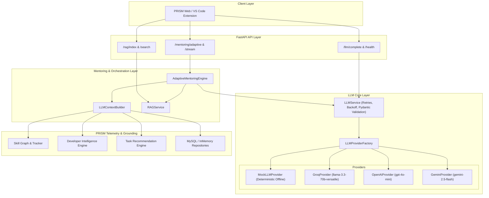

# PRISM IDE — Phase 20 LLM Architecture

## 1. Executive Summary

Phase 20 introduces the **LLM Intelligence Reasoning Layer** to PRISM IDE (*Personalized Real-time Intelligent Skill Mentor*). The LLM is designed strictly as a reasoning, pedagogical synthesis, and code comprehension layer that sits on top of PRISM's verified telemetry (skill graph, developer activity tracking, error insights, and knowledge gaps).

The architecture adheres to three core architectural pillars:
1. **Provider Independence:** Complete decoupling from proprietary vendor SDKs. A unified, provider-agnostic interface (`BaseLLMProvider`) supports Groq, OpenAI, Google Gemini, and a deterministic Mock provider.
2. **Zero Heavy AI Framework Bloat:** Strictly zero LangChain and zero ChromaDB. All networking uses modern async `httpx`, all validation uses Pydantic V2, and all streaming adheres to standard Server-Sent Events (SSE).
3. **Resilience & Offline Fallback:** When internet connectivity is absent or an LLM provider encounters rate limits/outages, PRISM automatically and transparently falls back to its deterministic pedagogical mentoring engine.

---

## 2. System Architecture Diagram



---

## 3. Core Components

### 3.1 Schemas & Contracts (`src/prism/llm/schemas.py`)
- `LLMRole`: `SYSTEM`, `USER`, `ASSISTANT`, `TOOL`.
- `LLMProviderType`: `MOCK`, `GROQ`, `OPENAI`, `GEMINI`.
- `LLMMessage`: Canonical message structure containing role, content, and optional metadata.
- `LLMRequest`: Input payload specifying messages, optional model override, temperature (default 0.2), max tokens, streaming flag, and response format.
- `LLMResponse`: Structured output containing generated content, provider name, model identifier, usage metrics (prompt, completion, total tokens), latency telemetry, and correlation ID.
- `StreamChunk`: Incremental token delta, finish reason (`stop`, `length`, or `None`), provider name, and model.
- `LLMHealthStatus`: Health probe outcome reporting status (`healthy`, `degraded`, `offline`), provider, model, latency in milliseconds, and optional error message.

### 3.2 Provider Abstraction (`src/prism/llm/base.py` & `providers/`)
All providers inherit from `BaseLLMProvider`:
```python
class BaseLLMProvider(ABC):
    @property
    @abstractmethod
    def provider_type(self) -> LLMProviderType: ...

    @property
    @abstractmethod
    def default_model(self) -> str: ...

    @abstractmethod
    async def generate(self, request: LLMRequest) -> LLMResponse: ...

    @abstractmethod
    def generate_stream(self, request: LLMRequest) -> AsyncIterator[StreamChunk]: ...

    @abstractmethod
    async def health_check(self) -> LLMHealthStatus: ...
```

- **OpenAICompatibleProvider:** Reusable HTTP client communicating with OpenAI-compatible REST endpoints using `httpx.AsyncClient`. Handles headers, JSON request payloads, error mapping, and SSE stream parsing (`data: {...}\n\n`).
- **GroqProvider:** Communicates with `https://api.groq.com/openai/v1` targeting `llama-3.3-70b-versatile` for high-throughput sub-second responses.
- **OpenAIProvider:** Communicates with `https://api.openai.com/v1` targeting `gpt-4o-mini`.
- **GeminiProvider:** Communicates with `https://generativelanguage.googleapis.com/v1beta/openai` targeting `gemini-2.5-flash` via Google's official OpenAI-compatible endpoint.
- **MockLLMProvider:** Zero-network in-memory provider delivering reproducible deterministic output, latency simulation, and fault injection for isolated testing.

### 3.3 Factory & Central Service (`src/prism/llm/factory.py` & `src/prism/llm/service.py`)
- **LLMProviderFactory:** Manages provider lifecycle, caching instances, reading environment configuration, and supporting dynamic registration of custom or test adapters.
- **LLMService:** Provides exponential backoff retries on transient errors (HTTP 429, timeouts, network hiccups), structured Pydantic validation via `complete_structured()` with automatic markdown code-fence stripping, and streaming orchestration.

---

## 4. Exception Hierarchy (`src/prism/llm/exceptions.py`)
All LLM-specific exceptions inherit from `LLMException`:
- `LLMAuthenticationError`: Invalid or missing API key (HTTP 401).
- `LLMRateLimitError`: Rate limit or quota exhaustion (HTTP 429).
- `LLMTimeoutError`: Network or provider timeout (HTTP 408 / 504).
- `LLMProviderError`: Upstream internal error (HTTP 500 / 502 / 503).
- `LLMValidationError`: Failure to parse output into expected structured schema.

---

## 5. Security & Token Budgeting
- All prompt contexts pass through `scrub_sensitive_data()` in `src/prism/llm/context_builder.py`, scrubbing API keys, database credentials, bearer tokens, and private keys.
- Token budgets enforce strict character caps on profile context ($\le 1200$ chars), skill context ($\le 1000$ chars), error telemetry ($\le 800$ chars), task context ($\le 600$ chars), and RAG context ($\le 1500$ chars), preventing context window blowup and excessive token consumption.
