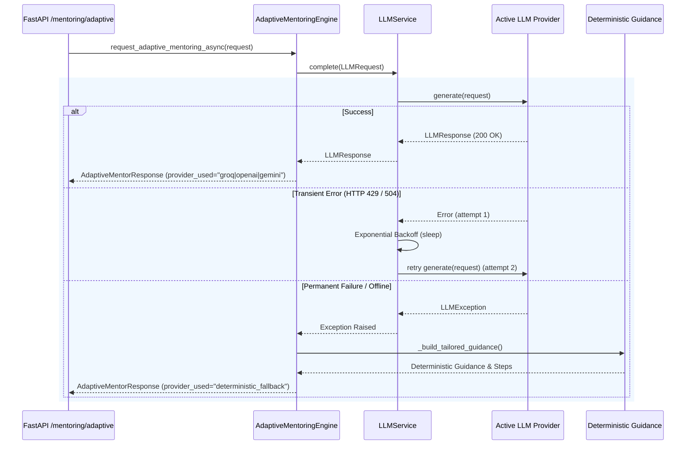

# PRISM IDE — Phase 20 LLM Provider Integration Guide

## 1. Overview

PRISM supports four LLM providers out of the box:
- **Groq:** Ultra-fast, open-weights inference (`llama-3.3-70b-versatile`).
- **OpenAI:** Industry benchmark models (`gpt-4o-mini`, `gpt-4o`).
- **Google Gemini:** Advanced reasoning and multimodal capability (`gemini-2.5-flash`).
- **Mock Provider:** Deterministic, offline, zero-network adapter for unit tests and local development.

---

## 2. Environment Configuration

All configuration is managed declaratively through environment variables (or `.env` in local development).
**Security Policy:** Never hardcode API keys or commit a `.env` file containing secrets. Use `.env.example` as a template.

### Configuration Variables (`.env`)
```bash
# =========================================================================
# LLM Intelligence Configuration (Phase 20)
# =========================================================================
LLM_PROVIDER=mock                      # Options: mock, groq, openai, gemini
LLM_MODEL=mock-model                   # Overrides default provider model if set
LLM_TEMPERATURE=0.2                    # Deterministic, pedagogical temperature (0.0 - 1.0)
LLM_MAX_TOKENS=2048                    # Response token limit
LLM_TIMEOUT_SECONDS=30.0               # Upstream HTTP request timeout
LLM_MAX_RETRIES=3                      # Max backoff retries for transient errors
LLM_RETRY_BACKOFF_FACTOR=2.0           # Exponential backoff factor

# Provider API Keys
GROQ_API_KEY=                          # Required if LLM_PROVIDER=groq
OPENAI_API_KEY=                        # Required if LLM_PROVIDER=openai
GEMINI_API_KEY=                        # Required if LLM_PROVIDER=gemini

# RAG Knowledge Retrieval Configuration
RAG_ENABLED=true
RAG_EMBEDDING_PROVIDER=deterministic   # Options: deterministic, remote
RAG_CHUNK_SIZE=500
RAG_CHUNK_OVERLAP=100
RAG_TOP_K=4
RAG_MIN_SIMILARITY=0.1
```

---

## 3. Provider Details

### 3.1 Groq Provider (`GroqProvider`)
- **Default Model:** `llama-3.3-70b-versatile`
- **Base URL:** `https://api.groq.com/openai/v1`
- **Authentication:** `Authorization: Bearer $GROQ_API_KEY`
- **Characteristics:** Sub-second latency, ideal for real-time keystroke and editor feedback.

### 3.2 OpenAI Provider (`OpenAIProvider`)
- **Default Model:** `gpt-4o-mini`
- **Base URL:** `https://api.openai.com/v1`
- **Authentication:** `Authorization: Bearer $OPENAI_API_KEY`
- **Characteristics:** Reliable structured JSON mode, high instruction following.

### 3.3 Google Gemini Provider (`GeminiProvider`)
- **Default Model:** `gemini-2.5-flash`
- **Base URL:** `https://generativelanguage.googleapis.com/v1beta/openai`
- **Authentication:** `Authorization: Bearer $GEMINI_API_KEY`
- **Characteristics:** High context window, strong technical reasoning, uses Google's official OpenAI-compatible endpoint without additional heavy SDKs.

### 3.4 Mock Provider (`MockLLMProvider`)
- **Default Model:** `mock-mentor-model`
- **Characteristics:** 100% offline, zero network I/O, deterministic responses, latency simulation, and fault injection for automated testing.

---

## 4. Provider Failover & Resilience Workflow



---

## 5. Programmatic Provider Switching

Providers can be dynamically switched at runtime without restarting the application:
```python
from prism.api.dependencies import get_llm_service
from prism.llm.factory import LLMProviderFactory

llm_service = get_llm_service()
# Switch active provider to Groq
new_provider = LLMProviderFactory.create_provider("groq")
llm_service.set_provider(new_provider)
```
