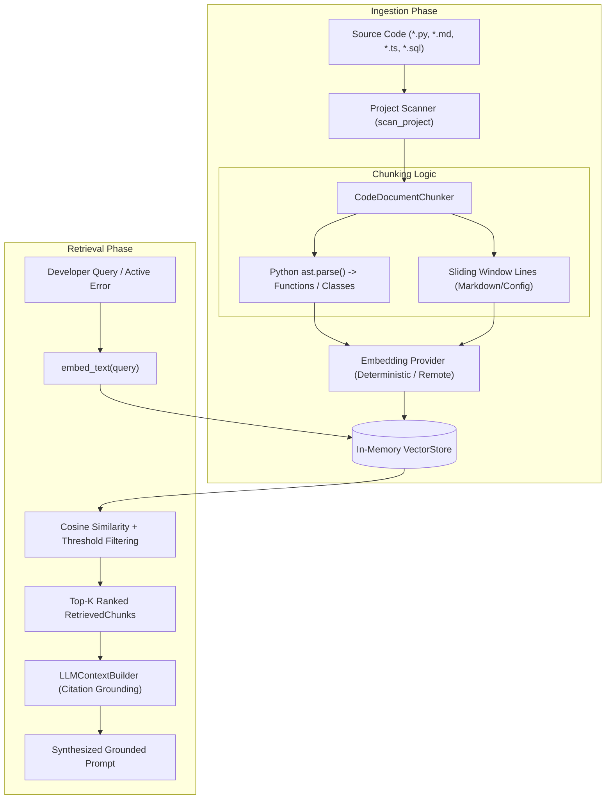

# PRISM IDE — Phase 20 RAG Architecture

## 1. Architectural Philosophy: Zero Heavy Dependencies

A critical design requirement of PRISM IDE is cross-platform reliability, fast startup, and compatibility with bleeding-edge runtimes (Python 3.14.7).
Traditional RAG frameworks introduce immense drawbacks:
- **LangChain:** Excessive layers of abstraction, brittle interfaces, dozens of transitive dependencies, and breaking changes across minor versions.
- **ChromaDB / Vector DBs:** Require C++ compilers, native sqlite3/hnswlib binaries, and heavy memory footprints that routinely fail to build on newer Python runtimes or Windows environments.

**PRISM's Solution:** A 100% Pure-Python RAG Pipeline designed from first principles:
- **AST-Aware Code Chunking:** Extracts classes, functions, and docstrings with exact line mappings.
- **Deterministic Embeddings:** Pure-Python 128-dimensional normalized vectors running offline with sub-millisecond execution.
- **In-Memory Cosine Vector Store:** High-performance vectorized search with exact source citations.

---

## 2. RAG Pipeline Workflow

---

## 3. Core Subsystems

### 3.1 AST-Aware Code Chunking (`src/prism/rag/chunker.py`)
- **Python Code (`.py`):** Uses standard library `ast.parse()` to traverse the Abstract Syntax Tree. Identifies module-level docstrings, top-level synchronous and asynchronous functions (`FunctionDef`, `AsyncFunctionDef`), and classes (`ClassDef`). Extracts line numbers (`lineno` to `end_lineno`) to provide line-level citations.
- **Prose & Markdown (`.md`, `.txt`):** Segments content by double newline paragraph boundaries.
- **Other Languages (`.ts`, `.js`, `.sql`, etc.):** Uses a sliding window with overlap (default 500 characters, 100 character overlap).
- **Resilience:** If AST parsing fails due to syntax errors or partial edits in the IDE buffer, the chunker automatically falls back to sliding line blocks without crashing.

### 3.2 Embedding Generation (`src/prism/rag/embeddings.py`)
- **`DeterministicEmbeddingProvider`:**
  - Produces 128-dimensional float vectors normalized to unit length ($||v||_2 = 1.0$).
  - Tokenizes code using identifier splitting, computes n-gram hashes, and projects term frequencies deterministically into the vector space.
  - Zero network dependencies, zero C-libraries, 100% reproducible across operating systems.
  - Generates embeddings in sub-millisecond time ($< 0.1$ms per chunk).
- **`RemoteEmbeddingProvider`:**
  - Supports standard OpenAI-compatible embedding endpoints (`text-embedding-3-small`).
  - Automatically falls back to `DeterministicEmbeddingProvider` if network connectivity fails or API keys are absent.

### 3.3 Vector Store & Retrieval (`src/prism/rag/vector_store.py`)
- **Similarity Metric:** Normalized Cosine Similarity:
  $$\text{sim}(u, v) = \frac{u \cdot v}{\|u\|_2 \|v\|_2} = \sum_{i=1}^{d} u_i v_i$$
- **Filters:** Supports filtering by `min_score` (threshold), `language`, and `project_path`.
- **Citations:** Formats precise source tags: `[Source: {file_path}:{start_line}-{end_line}]`.

### 3.4 High-Level RAG Service (`src/prism/rag/service.py`)
- `index_file(file_path, content)`: Indexes an individual buffer or file on disk.
- `index_project(project_path, max_files=100)`: Scans project directory using `scan_project`, indexing all supported files.
- `search(request: RAGQueryRequest) -> RAGSearchResult`: Runs similarity search and outputs timing telemetry (`duration_ms`).
- `build_rag_context(query, project_path, top_k=4)`: Synthesizes formatted context blocks containing citations and code fences for LLM consumption.
